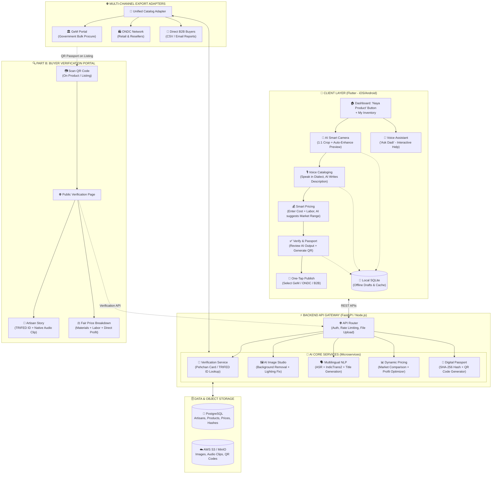

# ArtifyBharat (SIH PS 26090)
## AI-Powered Digital Business Manager & Cryptographic Heritage Passport for Artisans & Weavers

Smart India Hackathon Problem Statement 26090 — Technical Implementation Architecture & Scaffolded Monorepo.

---

## 📌 Architectural Vision & Executive Overview
Artify Bharat operates as an intelligent Digital Business Manager and Digital Gatekeeper for rural Indian artisans and weavers, systematically abstracting digital literacy barriers:
1. **Client Layer (Mobile Flutter / Android Native & Interactive Web Simulator)**: Zero-skill Dashboard with 'Naya Product' & 'My Inventory', AI Smart Camera (1:1 Crop + Auto-Enhance Preview), Voice Cataloging in regional dialects, Smart Pricing with market range suggestion & Fair Wage Floor, Digital Passport verification & QR generator, One-Tap Multi-Channel publish, and the **'Ask Dadi' (दादी से पूछो)** interactive voice assistant backed by local SQLite offline drafts.
2. **Backend API Gateway (FastAPI)**: Authentication, rate limiting, and multipart file upload management.
3. **AI Core Microservices**:
   - **AuthService**: Pehchan Card and TRIFED ID database lookup and validation.
   - **ImageAI (AI Image Studio)**: Salient object segmentation (U²-Net), background removal, OpenCV CLAHE lighting auto-fix, and 1:1 auto-cropping.
   - **LangAI (Multilingual NLP & Assistant)**: Whisper dialect ASR, IndicTrans2 translation, Mistral-7B metadata extraction, and 'Ask Dadi' voice engine.
   - **PricingAI (Dynamic Pricing Engine)**: XGBoost regression engine calculating recommended market price range and Fair Wage Floor protection.
   - **QRService (Digital Passport Engine)**: Cryptographic SHA-256 provenance hashing and QR code generation.
4. **Data & Object Storage**: PostgreSQL for structured entities & AWS S3 / MinIO for media assets.
5. **Multi-Channel Export Adapters**: Unified Catalog Adapter publishing directly to GeM Portal (XML/CSV), ONDC Network (Beckn Protocol JSON), and Direct B2B Buyers.
6. **Buyer Verification Portal (Part B)**: Public provenance verification (`/verify/{hash}`), verified Artisan Story with native dialect audio player, and 0% Middleman Fair Price Breakdown.

---

## 🏗️ Architecture Diagram



---

## 🗂️ Monorepo Structure

```
artify-bharat-sih/
├── backend/                        # FastAPI Async Backend & AI Services
│   ├── app/
│   │   ├── api/v1/                 # Endpoints: auth, studio, catalog, pricing, passport, exports, assistant
│   │   ├── core/                   # Security, DB sessions, Storage, SHA-256 Passport Crypto
│   │   ├── models/                 # SQLAlchemy 2.0 async models (Artisan, Product, Pricing, Passport)
│   │   ├── schemas/                # Pydantic v2 contracts (auth, studio, catalog, pricing, passport, export, assistant)
│   │   ├── services/               # Microservices: CV/ImageAI, LangAI, AssistantService, PricingAI, QRService, ExportService
│   │   ├── workers/                # Celery background tasks & price scraper
│   │   └── main.py                 # FastAPI application factory & lifecycle
│   ├── tests/                      # Comprehensive test suite
│   ├── migrations/                 # Alembic async database migrations
│   ├── pyproject.toml              # Modern uv project definition
│   └── Dockerfile                  # Production container definition
│
├── android/                        # Android Client (Kotlin + Jetpack Compose)
│   ├── app/
│   │   ├── src/main/java/in/artifybharat/app/
│   │   │   ├── domain/             # Pure Kotlin Domain Models, Repositories, UseCases
│   │   │   ├── data/               # Retrofit REST Service, Room/SQLite Offline Queue
│   │   │   └── presentation/       # 9-Screen Workflow, Indian Heritage Theme, NavGraph
│   │   └── build.gradle.kts
│   └── gradle/libs.versions.toml   # Dependency Version Catalog
│
├── harness/                        # Agent Harness (Schema-First Actions & Benchmarking)
│   ├── action_space.py             # Typed action schemas (micro, medium, macro tools)
│   ├── observation.py              # Standardized observation envelope formatter
│   ├── recovery.py                 # Error recovery contracts with stop gates
│   ├── evaluator.py                # Pass@1, Pass@3, completion rate benchmarking
│   └── harness_config.json         # Agent action space & budget constraints
│
├── web-portal/                     # Public Heritage Passport Verification Portal & Mobile Simulator
│   ├── index.html                  # Responsive provenance viewer & 6-stage interactive simulator
│   └── package.json                # Web build configuration
│
├── docs/                           # Architecture, specs, Notion blueprints, and ADRs
│   ├── architecture-mermaid.mmd    # Canonical system architecture
│   ├── architecture.md             # Complete architecture spec
│   ├── api-specification.md        # API reference documentation
│   └── heritage-passport-spec.md   # Cryptographic provenance specification
│
├── CONTEXT.md                      # Core ubiquitous language & domain concepts
├── CONTEXT-MAP.md                  # Monorepo bounded contexts map
├── AGENTS.md                       # Agent instructions & skill registry
├── docker-compose.yml              # Complete local stack (PostgreSQL, Redis, MinIO, Backend, Worker, Web)
├── .env.example                    # Environment variable configuration template
└── .github/workflows/ci.yml        # Continuous integration pipeline
```

---

## 🚀 Quickstart Guide

### 1. Backend & Tests
```bash
cd backend
uv sync --extra dev
uv run pytest -v
uv run uvicorn app.main:app --reload --host 0.0.0.0 --port 8000
```
Interactive API documentation: `http://localhost:8000/docs`

### 2. Android App (Kotlin + Jetpack Compose)
Open `android/` directory in Android Studio and run on an Android Device or Emulator:
```bash
cd android
./gradlew assembleDebug
```

### 3. Web Verification Portal & Mobile Simulator
Open `web-portal/index.html` in your browser or run:
```bash
cd web-portal
npm install
npm run dev
```

### 4. Full Docker Stack
```bash
docker-compose up -d --build
```
