# 🏛️ ArtifyBharat (SIH PS 26090)
> **AI-Powered Digital Business Manager & Gatekeeper for Rural Weavers & Artisans**  
> **Ministry of Social Justice and Empowerment (MoSJE)** | Smart India Hackathon

---

## 🌟 Executive Overview
**Artify Bharat** empowers rural Indian handloom weavers and handicraft artisans to seamlessly catalog, price, cryptographically verify, print physical thermal tags, and publish their heritage products directly from modern web browsers to national digital public infrastructure (**GeM**, **ONDC**, **WhatsApp Web**, and **SHG/NGO Bulk Portals**).

By introducing **Zero-Trust Peer Verification**, **native Android camera/GPS and timestamp provenance**, **Bluetooth 58mm ESC/POS thermal label generation**, and **Direct Jan Dhan / UPI Payouts**, Artify Bharat eliminates predatory middlemen and counterfeit machine-made replicas while providing the **Ministry of Social Justice and Empowerment (MoSJE)** real-time oversight via the **District Economic Heatmap Dashboard**.

## Product Platform Split

- **Artisan Android app (`android/`)**: the complete artisan workspace, including onboarding, phone/PIN authentication, camera evidence, voice cataloging, fair-wage pricing, Digital Heritage Passport creation, thermal printing, SHG coordination, offline drafts, and background sync.
- **Buyer web portal (`frontend_artifact/`)**: public QR/shortcode passport verification, provenance story, fair-price breakdown, and counterfeit reporting. Buyers do not need the Android app.
- **Ministry web dashboard (`frontend_artifact/`)**: authenticated monitoring for district heatmaps, verification/audit activity, PM-DAKSH metrics, demand forecasts, exports, and operational management.
- **Backend API (`backend/`)**: shared authentication, catalog, AI, verification, pricing, passport, payout, logistics, export, and Ministry data services used by both web and Android clients.

The web application is therefore for **buyers and Ministry/administrative users**. Artisan creation and management flows should be implemented and released through the Android app.

---

## 🏗️ System Architecture

```mermaid
flowchart TD
    %% =======================================================
    %% ARTIFY BHARAT WEB ARCHITECTURE (SIH PS 26090)
    %% Ministry of Social Justice and Empowerment (MoSJE)
    %% =======================================================

    subgraph Client["📱 ARTISAN CLIENT (Native Android - Kotlin / Jetpack Compose)"]
        direction TB
        
        subgraph UserModes["👤 Dual-Role Access Engine"]
            ArtisanUI["🧑🎨 Artisan Direct Mode<br>(Native Android app)"]
            SHGUI["👥 Aggregator / SHG Leader Mode<br>(Multi-Tenant Coordinator Hub)"]
        end

        UI_Dash["🏠 Smart Web Dashboard<br>('Naya Product' + Live Inventory Sync)"]
        
        subgraph SmartCaptureBox["📸 Web Media Capture & Authentication"]
            UI_Capture["📸 Native Camera Capture<br>(CameraX, 1:1 Aspect Ratio, WIP + Final Upload)"]
            UI_GPS["📍 Geolocation API & Timestamp Lock<br>(Live Metadata Verification)"]
        end

        UI_Voice["🎙️ Zero-Literacy Audio Engine<br>(Web Speech API / Bhashini Audio Stream)"]
        UI_Price["💰 Fair Wage & Dynamic Pricing<br>(Cost + Hours + Interactive Range Slider)"]
        UI_Verify["✅ Verification & Tagging<br>(Digital Passport + 6-Char Shortcode)"]
        
        subgraph HardwareLayer["🖨️ Physical Hardware Layer"]
            ThermalPrinter["🖨️ Android Bluetooth Printer<br>(58mm ESC/POS Bridge)"]
        end

        UI_Export["🚀 One-Tap Multi-Channel Publish<br>(GeM / ONDC / WhatsApp Web)"]
        UI_Help["💬 'Ask Dadi' Voice Assistant<br>(Interactive Guidance + PM-DAKSH Nudges)"]
        
        OfflineDB[("📂 Encrypted Room Database<br>(Offline Drafts, Audio Cache & Shortcodes)")]
        SyncEngine["🔄 Android WorkManager Sync<br>(Background Auto-Retry Queue)"]

        UserModes --> UI_Dash
        UI_Dash --> UI_Capture --> UI_GPS --> UI_Voice --> UI_Price --> UI_Verify
        UI_Verify --> ThermalPrinter
        UI_Verify --> UI_Export
        UI_Capture -.-> OfflineDB
        UI_Voice -.-> OfflineDB
        UI_Verify -.-> OfflineDB
        OfflineDB --> SyncEngine
        UI_Dash --> UI_Help
    end

    subgraph Backend["⚡ BACKEND API GATEWAY (FastAPI / Node.js)"]
        direction TB
        Gateway["🌐 API Gateway & Router<br>(Auth, Rate Limiting, File Uploads, Webhook Receiver)"]
        
        subgraph CoreServices["🧠 AI CORE SERVICES & DPI MICROSERVICES"]
            AuthService["🪪 MoSJE & e-Shram Auth<br>(PM-SURAJ / PM-DAKSH / e-KYC Lookup)"]
            ImageAI["🖼️ Image Studio Engine<br>(rembg U-2-Net Background Removal + OpenCV CLAHE)"]
            LangAI["🗣️ Multilingual Voice NLP<br>(Whisper ASR + IndicTrans2 + Audio TTS)"]
            PricingAI["📊 Dynamic Pricing Engine<br>(Fair Skilled-Wage Floor + Market Benchmarks)"]
            VerifyService["🔐 Zero-Trust Verification Engine<br>(Random Peer Jury + AI Rubber-Stamp Anomaly Check)"]
            QRService["🏷️ Digital Passport Service<br>(SHA-256 Hash + QR & Shortcode Generator)"]
            LogisticsService["📦 First-Mile Logistics Adapter<br>(India Post / CSC Drop-off PIN & Barcode)"]
            PayoutService["💳 Direct Jan Dhan / UPI Payout<br>(Middleman-Free Escrow & Settlement)"]
            NotifyService["📲 SMS & IVR Engine<br>(Bhashini Voice Alerts for Offline Orders)"]
        end

        Gateway --> AuthService
        Gateway --> ImageAI
        Gateway --> LangAI
        Gateway --> PricingAI
        Gateway --> VerifyService
        Gateway --> QRService
        Gateway --> LogisticsService
        Gateway --> PayoutService
        Gateway --> NotifyService
    end

    subgraph Storage["🗄️ DATA & OBJECT STORAGE"]
        SQL_DB[("🐘 PostgreSQL DB<br>Artisans, Audit Hashes, Benchmarks, Verification Jury Queue")]
        Media_DB[("☁️ AWS S3 / MinIO<br>Raw/WIP Images, Studio Images, Audio Clips, QR SVGs")]
        PII_Vault[("🛡️ Secure PII Vault<br>(Tokenized E-Shram & Bank Details - DPDP Compliant)")]
    end

    subgraph Exports["🌐 MULTI-CHANNEL EXPORT & SYNC ADAPTERS"]
        Adapter["🔄 Unified Bi-Directional Sync Adapter"]
        GeM["🏛️ GeM Portal<br>(Government B2G Bulk Orders)"]
        ONDC["🛍️ ONDC Beckn Node<br>(B2C Retail Marketplaces)"]
        WA["💬 WhatsApp Commerce Bot<br>(Direct Customer Catalog & UPI Link)"]
        NGO["🏢 SHG / NGO Bulk Portal<br>(B2B Wholesale Catalog)"]
        
        Adapter <-->|Bi-Directional Order Sync| GeM
        Adapter <-->|Stock Deduction Webhooks| ONDC
        Adapter <-->|Catalog Push| WA
        Adapter <-->|Wholesale Export| NGO
    end

    subgraph Buyer["🔍 BUYER VERIFICATION PORTAL"]
        Scan["📷 Scan QR Code OR Enter 6-Char Code<br>(e.g., artify.gov.in/A7X-9B2)"]
        Portal["🌐 Public Digital Passport Portal"]
        Story["👤 Verified Artisan Origin<br>(MoSJE Status + WIP Photo + Native Audio Story)"]
        Cost["⚖️ Fair Price Breakdown<br>(Materials + Fair Labor + Profit + Packaging)"]
        Report["🚩 Anti-Fraud Feedback Loop<br>('Report Fake / Machine-Made' Audit Trigger)"]

        Scan --> Portal --> Story
        Portal --> Cost
        Portal --> Report
    end

    subgraph AdminPortal["📊 MINISTRY & ADMIN DASHBOARD"]
        AdminWeb["🌐 MoSJE Nodal Officer / DM Dashboard<br>(React / Next.js)"]
        Heatmap["🗺️ Live District Economic Heatmap"]
        AuditLog["📋 Anti-Corruption & Peer-Review Logs"]
        UpskillMetrics["🎓 Skill Upskilling Analytics (PM-DAKSH)"]
        DemandForecast["📈 Predictive Demand AI<br>(Festival Trend Forecasting)"]

        AdminWeb --> Heatmap
        AdminWeb --> AuditLog
        AdminWeb --> UpskillMetrics
        AdminWeb --> DemandForecast
    end

    %% ========== SYSTEM CONNECTIONS ==========
    Client <-->|REST APIs & WebSockets| Gateway
    SyncEngine ==>|Batch Uploads| Gateway
    CoreServices <--> Storage
    CoreServices <--> PII_Vault
    Adapter <--> CoreServices
    Adapter --> Exports

    Exports -.->|QR Passport on Product Listing| Scan
    Portal -.->|Verification API| Gateway
    Report -.->|Flags Verifier & Triggers Audit| VerifyService
    Gateway <--> AdminWeb

    %% ========== STYLING ==========
    classDef web fill:#FFF7ED,stroke:#EA580C,stroke-width:2px,color:#9A3412;
    classDef backend fill:#EFF6FF,stroke:#2563EB,stroke-width:2px,color:#1E40AF;
    classDef ai fill:#FAF5FF,stroke:#9333EA,stroke-width:2px,color:#6B21A8;
    classDef data fill:#F0FDF4,stroke:#16A34A,stroke-width:2px,color:#166534;
    classDef export fill:#FEFCE8,stroke:#CA8A04,stroke-width:2px,color:#854D0E;
    classDef buyer fill:#F8FAFC,stroke:#0F172A,stroke-width:2px,color:#0F172A;
    classDef admin fill:#FEF2F2,stroke:#DC2626,stroke-width:2px,color:#991B1B;

    class UI_Dash,UI_Capture,UI_GPS,UI_Voice,UI_Price,UI_Verify,ThermalPrinter,UI_Export,UI_Help,OfflineDB,SyncEngine,ArtisanUI,SHGUI web;
    class Gateway,AuthService,ImageAI,LangAI,PricingAI,VerifyService,QRService,LogisticsService,PayoutService,NotifyService backend;
    class SQL_DB,Media_DB,PII_Vault data;
    class Adapter,GeM,ONDC,WA,NGO export;
    class Scan,Portal,Story,Cost,Report buyer;
    class AdminWeb,Heatmap,AuditLog,UpskillMetrics,DemandForecast admin;
```



---

## 💎 Core Innovation Highlights

| Innovation Layer | Key Capabilities |
|---|---|
| **Dual-Role Web Access Engine** | Solo Artisan Direct Mode + Multi-Tenant SHG Leader Hub (managing up to 50 village craftspeople) |
| **Browser Media & Hardware Lock** | In-browser `MediaDevices API` (1:1 crop + Gyro Leveling) + W3C `Geolocation API` & Timestamp Lock + Dual WIP/Final Photo Proof |
| **Web Bluetooth Thermal Printing** | Direct browser-to-printer `Web Bluetooth API` bridge streaming 58mm ESC/POS raw byte streams for sticky QR tags |
| **Zero-Trust Verification Engine** | Randomized 3-artisan peer jury quorum + AI rubber-stamp anomaly detector + 6-Char shortcode resolver (`A7X-9B2`) |
| **Fair Wage & Jan Dhan Escrow** | Statutory wage floor protection + 3-tier interactive slider + Middleman-free Jan Dhan / UPI instant payouts |
| **First-Mile Logistics** | India Post & Common Service Center (CSC) PIN routing, barcode generation, and dispatch tracking |
| **Anti-Fraud Feedback Loop** | Consumer "Report Fake / Machine-Made" audit trigger with direct escalation to MoSJE Nodal Officers |
| **Ministry Admin Dashboard** | Live District Economic Heatmaps, Peer Jury Audit Trails, PM-DAKSH Upskilling Analytics, and Festive Demand AI |

---

## 🚀 Getting Started

### Backend Setup (FastAPI & AI Microservices)
```bash
cd backend
uv sync
uv run uvicorn app.main:app --reload --port 8000
```

### Running Backend Tests
```bash
cd backend
uv run pytest -v
```

### Web App & Portals (Buyer Verification & MoSJE Admin Dashboard)
```bash
cd web-portal
# Open index.html in your browser or run a lightweight web server:
npx serve .
```

### Artisan Android App
```bash
cd android
./gradlew assembleDebug
```

Install the generated debug APK on an Android device or emulator. The Android app is the primary artisan client; the web app is not required for artisan capture, cataloging, pricing, or printing.

---

## 📚 Complete Project Documentation

- 🎨 [**Frontend Master UI/UX & Feature Specification**](docs/frontend-master-ui-spec.md)
- 📝 [**Complete Master Notion Blueprint (Ready to Copy-Paste)**](docs/notion-project-blueprint.md)
- 📋 [**Complete Task List, Tech Stack Matrix & Zero-Break Roadmap**](docs/complete-task-and-tech-roadmap.md)
- 🔌 [**Complete API Directory & Environment Setup Guide (.env)**](docs/api-directory-and-env-guide.md)
- 🧑‍🎨 [**Artisan & SHG End-to-End Flow & Pitch Defenses**](docs/artisan-end-to-end-flow.md)
- 🛍️ [**Buyer Public Passport & Anti-Fraud Verification Flow**](docs/buyer-end-to-end-flow.md)
- 🏛️ [**6-Layer System Architecture & DPI Microservices**](docs/architecture.md)
- 🔌 [**OpenAPI / REST API Specification**](docs/api-specification.md)
- 🗺️ [**Interactive Architecture Flowchart (Mermaid)**](docs/architecture-mermaid.mmd)


