# ArtifyBharat Web Architecture Specification (MoSJE - SIH PS 26090)

## 1. System Context & Overview
**Artify Bharat** is an AI-powered Digital Business Manager & Digital Gatekeeper built for the **Ministry of Social Justice and Empowerment (MoSJE)** under Smart India Hackathon (SIH PS 26090). It uses a native Android app for artisan work and web portals for public buyer verification and Ministry operations. Artisans catalog, price, verify, and publish heritage products from Android to national digital public infrastructure (**GeM**, **ONDC**, **WhatsApp Web**, and **SHG/NGO Bulk Portals**).

### Platform Boundaries

| Platform | Primary users | Responsibility |
|---|---|---|
| Native Android app (`android/`) | Artisans, SHG coordinators | Onboarding, camera and voice capture, GPS provenance, cataloging, fair-wage pricing, passport creation, thermal printing, offline work, and sync |
| Buyer web portal | Buyers and the public | QR/shortcode verification, artisan story, price transparency, and fake-product reports |
| Ministry web dashboard | MoSJE officers, district managers, administrators | District heatmaps, audit logs, jury monitoring, PM-DAKSH metrics, forecasts, exports, and operational management |
| FastAPI backend | Shared platform services | Auth, storage, AI, verification, pricing, passport, payout, logistics, exports, and APIs |

```mermaid
flowchart TD
    %% =======================================================
    %% ARTIFY BHARAT WEB ARCHITECTURE (SIH PS 26090)
    %% Ministry of Social Justice and Empowerment (MoSJE)
    %% =======================================================

    subgraph AndroidClient["📱 ARTISAN CLIENT (Native Android - Kotlin / Jetpack Compose)"]
        direction TB
        
        subgraph UserModes["👤 Dual-Role Access Engine"]
            ArtisanUI["🧑🎨 Artisan Direct Mode<br>(Native Android app)"]
                SHGUI["👥 Aggregator / SHG Leader Mode<br>(Android coordinator hub)"]
        end

        UI_Dash["🏠 Smart Artisan Dashboard<br>('Naya Product' + Live Inventory Sync)"]
        
        subgraph SmartCaptureBox["📸 Native Media Capture & Authentication"]
            UI_Capture["📸 CameraX Capture<br>(1:1 Aspect Ratio, WIP + Final Upload)"]
            UI_GPS["📍 Geolocation API & Timestamp Lock<br>(Live Metadata Verification)"]
        end

        UI_Voice["🎙️ Zero-Literacy Audio Engine<br>(Android audio / Bhashini Stream)"]
        UI_Price["💰 Fair Wage & Dynamic Pricing<br>(Cost + Hours + Interactive Range Slider)"]
        UI_Verify["✅ Verification & Tagging<br>(Digital Passport + 6-Char Shortcode)"]
        
        subgraph HardwareLayer["🖨️ Physical Hardware Layer"]
            ThermalPrinter["🖨️ Android Bluetooth Printer<br>(58mm ESC/POS Bridge)"]
        end

        UI_Export["🚀 One-Tap Multi-Channel Publish<br>(GeM / ONDC / WhatsApp Web)"]
        UI_Help["💬 'Ask Dadi' Voice Assistant<br>(Interactive Guidance + PM-DAKSH Nudges)"]
        
        OfflineDB[("📂 Encrypted Room Database<br>(Offline Drafts, Audio Cache & Shortcodes)")]
        SyncEngine["🔄 Android WorkManager Sync<br>(Background Auto-Retry Queue)"]

        UserModes --> UI_Dash
        UI_Dash --> UI_Capture --> UI_GPS --> UI_Voice --> UI_Price --> UI_Verify
        UI_Verify --> ThermalPrinter
        UI_Verify --> UI_Export
        UI_Capture -.-> OfflineDB
        UI_Voice -.-> OfflineDB
        UI_Verify -.-> OfflineDB
        OfflineDB --> SyncEngine
        UI_Dash --> UI_Help
    end

    subgraph WebClients["🌐 WEB CLIENTS (Buyer + Ministry)"]
        BuyerWeb["🔍 Public Buyer Passport Portal<br>(QR / Shortcode Verification)"]
        MinistryWeb["📊 MoSJE Ministry Dashboard<br>(District, Audit, PM-DAKSH, Forecasts)"]
    end

    subgraph Backend["⚡ BACKEND API GATEWAY (FastAPI / Node.js)"]
        direction TB
        Gateway["🌐 API Gateway & Router<br>(Auth, Rate Limiting, File Uploads, Webhook Receiver)"]
        
        subgraph CoreServices["🧠 AI CORE SERVICES & DPI MICROSERVICES"]
            AuthService["🪪 MoSJE & e-Shram Auth<br>(PM-SURAJ / PM-DAKSH / e-KYC Lookup)"]
            ImageAI["🖼️ Image Studio Engine<br>(rembg U-2-Net Background Removal + OpenCV CLAHE)"]
            LangAI["🗣️ Multilingual Voice NLP<br>(Whisper ASR + IndicTrans2 + Audio TTS)"]
            PricingAI["📊 Dynamic Pricing Engine<br>(Fair Skilled-Wage Floor + Market Benchmarks)"]
            VerifyService["🔐 Zero-Trust Verification Engine<br>(Random Peer Jury + AI Rubber-Stamp Anomaly Check)"]
            QRService["🏷️ Digital Passport Service<br>(SHA-256 Hash + QR & Shortcode Generator)"]
            LogisticsService["📦 First-Mile Logistics Adapter<br>(India Post / CSC Drop-off PIN & Barcode)"]
            PayoutService["💳 Direct Jan Dhan / UPI Payout<br>(Middleman-Free Escrow & Settlement)"]
            NotifyService["📲 SMS & IVR Engine<br>(Bhashini Voice Alerts for Offline Orders)"]
        end

        Gateway --> AuthService
        Gateway --> ImageAI
        Gateway --> LangAI
        Gateway --> PricingAI
        Gateway --> VerifyService
        Gateway --> QRService
        Gateway --> LogisticsService
        Gateway --> PayoutService
        Gateway --> NotifyService
    end

    subgraph Storage["🗄️ DATA & OBJECT STORAGE"]
        SQL_DB[("🐘 PostgreSQL DB<br>Artisans, Audit Hashes, Benchmarks, Verification Jury Queue")]
        Media_DB[("☁️ AWS S3 / MinIO<br>Raw/WIP Images, Studio Images, Audio Clips, QR SVGs")]
        PII_Vault[("🛡️ Secure PII Vault<br>(Tokenized E-Shram & Bank Details - DPDP Compliant)")]
    end

    subgraph Exports["🌐 MULTI-CHANNEL EXPORT & SYNC ADAPTERS"]
        Adapter["🔄 Unified Bi-Directional Sync Adapter"]
        GeM["🏛️ GeM Portal<br>(Government B2G Bulk Orders)"]
        ONDC["🛍️ ONDC Beckn Node<br>(B2C Retail Marketplaces)"]
        WA["💬 WhatsApp Commerce Bot<br>(Direct Customer Catalog & UPI Link)"]
        NGO["🏢 SHG / NGO Bulk Portal<br>(B2B Wholesale Catalog)"]
        
        Adapter <-->|Bi-Directional Order Sync| GeM
        Adapter <-->|Stock Deduction Webhooks| ONDC
        Adapter <-->|Catalog Push| WA
        Adapter <-->|Wholesale Export| NGO
    end

    subgraph Buyer["🔍 BUYER VERIFICATION PORTAL"]
        Scan["📷 Scan QR Code OR Enter 6-Char Code<br>(e.g., artify.gov.in/A7X-9B2)"]
        Portal["🌐 Public Digital Passport Portal"]
        Story["👤 Verified Artisan Origin<br>(MoSJE Status + WIP Photo + Native Audio Story)"]
        Cost["⚖️ Fair Price Breakdown<br>(Materials + Fair Labor + Profit + Packaging)"]
        Report["🚩 Anti-Fraud Feedback Loop<br>('Report Fake / Machine-Made' Audit Trigger)"]

        Scan --> Portal --> Story
        Portal --> Cost
        Portal --> Report
    end

    subgraph AdminPortal["📊 MINISTRY & ADMIN DASHBOARD"]
        AdminWeb["🌐 MoSJE Nodal Officer / DM Dashboard<br>(React / Next.js)"]
        Heatmap["🗺️ Live District Economic Heatmap"]
        AuditLog["📋 Anti-Corruption & Peer-Review Logs"]
        UpskillMetrics["🎓 Skill Upskilling Analytics (PM-DAKSH)"]
        DemandForecast["📈 Predictive Demand AI<br>(Festival Trend Forecasting)"]

        AdminWeb --> Heatmap
        AdminWeb --> AuditLog
        AdminWeb --> UpskillMetrics
        AdminWeb --> DemandForecast
    end

    %% ========== SYSTEM CONNECTIONS ==========
    AndroidClient <-->|REST APIs & WebSockets| Gateway
    WebClients <-->|REST APIs & WebSockets| Gateway
    SyncEngine ==>|Batch Uploads| Gateway
    CoreServices <--> Storage
    CoreServices <--> PII_Vault
    Adapter <--> CoreServices
    Adapter --> Exports

    Exports -.->|QR Passport on Product Listing| Scan
    Portal -.->|Verification API| Gateway
    Report -.->|Flags Verifier & Triggers Audit| VerifyService
    Gateway <--> AdminWeb

    %% ========== STYLING ==========
    classDef web fill:#FFF7ED,stroke:#EA580C,stroke-width:2px,color:#9A3412;
    classDef backend fill:#EFF6FF,stroke:#2563EB,stroke-width:2px,color:#1E40AF;
    classDef ai fill:#FAF5FF,stroke:#9333EA,stroke-width:2px,color:#6B21A8;
    classDef data fill:#F0FDF4,stroke:#16A34A,stroke-width:2px,color:#166534;
    classDef export fill:#FEFCE8,stroke:#CA8A04,stroke-width:2px,color:#854D0E;
    classDef buyer fill:#F8FAFC,stroke:#0F172A,stroke-width:2px,color:#0F172A;
    classDef admin fill:#FEF2F2,stroke:#DC2626,stroke-width:2px,color:#991B1B;

    class UI_Dash,UI_Capture,UI_GPS,UI_Voice,UI_Price,UI_Verify,ThermalPrinter,UI_Export,UI_Help,OfflineDB,SyncEngine,ArtisanUI,SHGUI web;
    class Gateway,AuthService,ImageAI,LangAI,PricingAI,VerifyService,QRService,LogisticsService,PayoutService,NotifyService backend;
    class SQL_DB,Media_DB,PII_Vault data;
    class Adapter,GeM,ONDC,WA,NGO export;
    class Scan,Portal,Story,Cost,Report buyer;
    class AdminWeb,Heatmap,AuditLog,UpskillMetrics,DemandForecast admin;
```

---

## 2. Layer-by-Layer Architectural Breakdown

### 🌐 1. Client Layer (Responsive Web - React / Next.js & Tailwind CSS)
- **Dual-Role Access Engine**:
  - **Artisan Direct Mode**: Single-user voice-first browser UI tailored for solo craftspeople.
  - **Aggregator / SHG Leader Mode**: Multi-tenant coordinator hub for SHG leads, village coordinators, and CSC VLEs managing up to 50 local artisans.
- **Smart Web Dashboard (`UI_Dash`)**: Home screen featuring instant **'Naya Product'** launch CTA and real-time inventory synchronization.
- **Web Media Capture & Authentication**:
  - **Browser Media Capture (`UI_Capture`)**: HTML5 `MediaDevices API` (camera stream), strict 1:1 aspect ratio constraint, dual-mode WIP and finished product photo capture.
  - **Geolocation API & Timestamp Lock (`UI_GPS`)**: Live W3C Geolocation coordinates (`lat/lng`) and tamper-proof UTC timestamp binding.
- **Zero-Literacy Audio Engine (`UI_Voice`)**: Native browser `Web Speech API` & Bhashini voice streaming supporting 22 Indian regional dialects.
- **Fair Wage & Dynamic Pricing (`UI_Price`)**: Interactive range slider calculating statutory daily wage floors and real-time profit optimization.
- **Verification & Tagging (`UI_Verify`)**: Cryptographic SHA-256 Digital Passport synthesis and 6-character shortcode generator (`A7X-9B2`).
- **Physical Hardware Layer (`ThermalPrinter`)**: **Web Bluetooth API** bridge sending raw 58mm ESC/POS byte streams to portable thermal sticker printers directly from the browser.
- **One-Tap Multi-Channel Publish (`UI_Export`)**: Publishes listings to GeM, ONDC, and WhatsApp Web with one click.
- **'Ask Dadi' Voice Assistant (`UI_Help`)**: Interactive conversational AI avatar providing craft guidance, photo tips, and **PM-DAKSH** scheme training nudges.
- **Browser IndexedDB (`OfflineDB`)**: Client-side storage for offline product drafts, captured audio blobs, and shortcode keys.
- **Service Worker Sync (`SyncEngine`)**: Background sync queue (`ServiceWorker` / `BackgroundSync`) with exponential auto-retry batch uploading to the API Gateway upon reconnection.

---

### ⚡ 2. Backend API Gateway & DPI Microservices (FastAPI / Python)
- **API Gateway & Router**: Central entrance handling JWT token validation, rate-limiting, batch multipart uploads, and webhooks.
- **Core AI & DPI Microservices**:
  1. **AuthService (MoSJE & e-Shram Auth)**: Real-time verification of PM-SURAJ, PM-DAKSH, e-Shram, Pehchan ID, and TRIFED credentials.
  2. **ImageAI (Image Studio Engine)**: U²-Net AI background removal (`rembg`), OpenCV CLAHE contrast enhancement in LAB color space, gamma normalization, and centered 1:1 auto-cropping.
  3. **LangAI (Multilingual Voice NLP)**: Whisper ASR for regional dialects, IndicTrans2 neural translation across 22 scheduled languages, and Bhashini TTS.
  4. **PricingAI (Dynamic Pricing Engine)**: Statutory wage floor enforcement with XGBoost regression.
  5. **VerifyService (Zero-Trust Verification Engine)**: 3-artisan randomized peer jury quorum, AI rubber-stamp anomaly detection, and anti-fraud reporting.
  6. **QRService (Digital Passport Service)**: Deterministic SHA-256 hash digests, vector QR code SVG generation, and 6-char shortcode minting (`A7X-9B2`).
  7. **LogisticsService (First-Mile Logistics Adapter)**: India Post Speed Post & CSC Drop-off PIN routing and barcode generation.
  8. **PayoutService (Direct Jan Dhan / UPI Payout)**: Middleman-free Jan Dhan escrow settlement and instant UPI transfer.
  9. **NotifyService (SMS & IVR Engine)**: Automated SMS & IVR voice alerts in native dialect informing offline artisans about new orders and payouts.

---

### 🗄️ 3. Data & Object Storage
- **PostgreSQL Database (`SQL_DB`)**: Relational storage for artisan profiles, audit hashes, pricing benchmarks, and peer jury queues.
- **Object Storage (`Media_DB`)**: AWS S3 / MinIO buckets for WIP captures, studio-enhanced PNGs, audio streams, and vector QR codes.
- **Secure PII Vault (`PII_Vault`)**: Tokenized, encrypted vault for e-Shram UANs, Aadhaar tokens, and Jan Dhan bank details compliant with the Digital Personal Data Protection (DPDP) Act.

---

### 🌐 4. Multi-Channel Export & Sync Adapters
- **Unified Bi-Directional Sync Adapter (`Adapter`)**:
  - **GeM Portal**: B2G government procurement with bi-directional order synchronization.
  - **ONDC Beckn Node**: B2C retail with real-time stock deduction webhooks.
  - **WhatsApp Commerce Bot**: Push catalog generation with UPI payment links.
  - **SHG / NGO Bulk Portal**: B2B wholesale catalog with tiered volume pricing.

---

### 🔍 5. Buyer Verification Portal
- **Scan & Shortcode Input (`Scan`)**: Scan QR sticker or enter 6-character shortcode (`artify.gov.in/A7X-9B2`).
- **Public Digital Passport Portal (`Portal`)**: High-trust cryptographic verification webpage.
- **Verified Artisan Origin (`Story`)**: MoSJE status badge, WIP photos proving handcrafting, and native dialect audio story.
- **Fair Price Breakdown (`Cost`)**: 4-part transparent cost disclosure (Raw Materials + Fair Labor Wages + Direct Artisan Profit + Packaging).
- **Anti-Fraud Feedback Loop (`Report`)**: **"🚩 Report Fake / Machine-Made"** trigger flagging items to `VerifyService`.

---

### 📊 6. Ministry & Admin Dashboard
- **MoSJE Nodal Officer / DM Dashboard (`AdminWeb`)**: Executive interface for District Magistrates and Nodal Officers.
- **Live District Economic Heatmap (`Heatmap`)**: Geospatial overview tracking wage disbursement and active artisans.
- **Anti-Corruption & Peer-Review Logs (`AuditLog`)**: Immutable audit logs of peer jury verdicts and fraud incident resolutions.
- **Skill Upskilling Analytics (`UpskillMetrics`)**: PM-DAKSH training completions and artisan wage multipliers.
- **Predictive Demand AI (`DemandForecast`)**: AI forecast models predicting festive demand surges (Diwali, Durga Puja, Pushkar Mela) for strategic cluster production planning.
