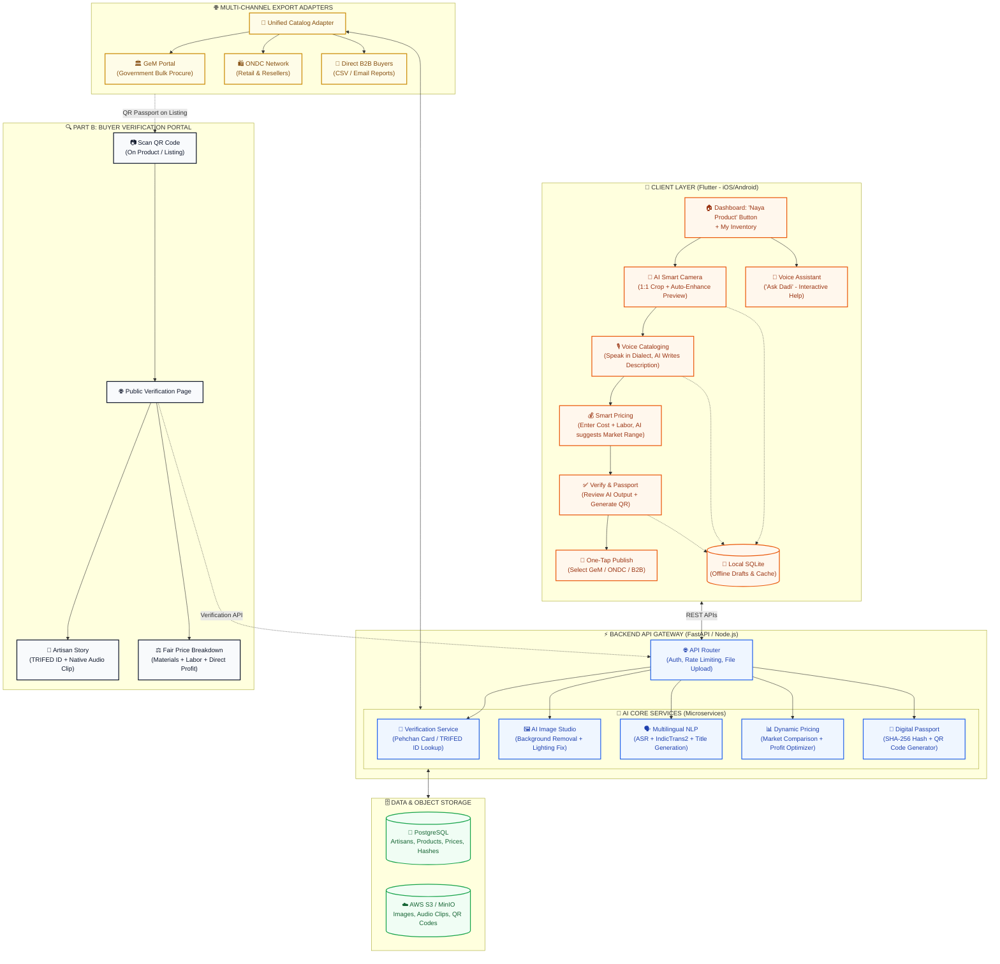

# ArtifyBharat Architecture Specification (SIH PS 26090)

## 1. System Context & Overview
Artify Bharat is an AI-powered Digital Business Manager & Digital Gatekeeper empowering rural Indian weavers and handicraft artisans to catalog, price, verify, and publish their heritage products to national channels (GeM, ONDC, B2B) while eliminating counterfeit market competition through cryptographic provenance.

---

## 2. Layer-by-Layer Architectural Breakdown

### 📱 Client Layer (Mobile: Android / Flutter & Interactive Client App)
- **UI_Dash (Dashboard)**: Primary zero-skill entry point featuring prominent **"Naya Product"** button, craft cluster status, and **"My Inventory"** management for active listings and draft synchronization.
- **UI_Capture (AI Smart Camera)**: High-precision camera viewfinder with strict **1:1 square crop** constraint and real-time on-device auto-enhance preview.
- **UI_Voice (Voice Cataloging)**: Audio recorder capturing native rural dialects (Bhojpuri, Maithili, Hindi, etc.) parsed into structured titles and descriptions.
- **UI_Price (Smart Pricing)**: Touch keypad to enter material cost and labor days, with AI market range calculation and Fair Wage Floor protection.
- **UI_Verify (Verify & Passport)**: Preview synthesized studio images, verified metadata, and live generation of the cryptographic SHA-256 Digital Passport & QR code.
- **UI_Export (One-Tap Publish)**: Select one or more target channels (GeM, ONDC, B2B) and publish with one touch.
- **UI_Help ('Ask Dadi' Voice Assistant)**: Interactive multilingual AI voice assistant guiding artisans through cataloging, photography, fair pricing, and government schemes.
- **OfflineDB (Local SQLite)**: Persistent offline draft queue and local media cache enabling full catalog creation in low-bandwidth rural conditions with background auto-sync.

### ⚡ Backend API Gateway (FastAPI / Node.js)
- Central gateway providing JWT authentication, rate limiting, request validation, multipart file uploads, and asynchronous worker orchestration.

### 🧠 AI Core Services (Microservices Architecture)
1. **AuthService (Verification Service)**:
   - Real-time lookup and validation of government **Pehchan Card** numbers, **TRIFED Artisan IDs**, GI registry credentials, and PM Vishwakarma registrations.
2. **ImageAI (AI Image Studio)**:
   - Salient object segmentation (U²-Net), background removal, OpenCV CLAHE LAB color and lighting auto-fix, centered 1:1 auto-cropping, and visual complexity scoring.
3. **LangAI (Multilingual NLP & Voice Assistant)**:
   - Automatic Speech Recognition (Whisper) for regional dialects, neural translation via IndicTrans2, LLM metadata extraction (Mistral-7B), and **'Ask Dadi'** conversational dialect assistant.
4. **PricingAI (Dynamic Pricing & Profit Optimizer)**:
   - XGBoost regression engine calculating recommended market price ranges based on raw material cost, labor days, visual complexity, and live marketplace benchmark data while guaranteeing statutory Fair Wage floors.
5. **QRService (Digital Passport Engine)**:
   - Cryptographic engine computing canonical SHA-256 provenance hashes over artisan identity, product credentials, geolocation, and cost breakdown, paired with high-contrast QR code generation.

### 🗄️ Data & Object Storage
- **PostgreSQL**: Relational storage for artisan profiles, Pehchan/TRIFED records, product catalogs, statutory price logs, and SHA-256 verification digests.
- **AWS S3 / MinIO**: Object storage for raw photos, 1:1 enhanced studio PNGs, native dialect voice clips, and generated QR passport assets.

### 🌐 Multi-Channel Export Adapters
- **Unified Catalog Adapter**:
  - **GeM Portal**: Formats data to Government e-Marketplace XML/CSV schema with HSN compliance and artisan registration IDs for institutional bulk procurement.
  - **ONDC Network**: Generates Beckn Protocol JSON catalog specifications for open retail and reseller networks.
  - **Direct B2B Buyers**: Formats enterprise bulk procurement invoices, tiered volume pricing, and CSV/PDF export reports.

### 🔍 Part B: Buyer Verification Portal
- **Scan**: Scan printed product tag or e-commerce listing QR code.
- **Public Verification Page**: High-trust web portal (`/verify/{hash}`) validating cryptographic SHA-256 authenticity.
- **Artisan Story**: Displays verified artisan profile, TRIFED/Pehchan ID, cluster location, and embedded audio player for native dialect story.
- **Fair Price Breakdown**: 0% middleman transparent cost card detailing Raw Materials, Fair Labor Wages, and Direct Artisan Profit.
