```mermaid
flowchart TD
    A1["📱 1. Open Web App & Grant Permissions<br>(Camera, Mic, GPS, Bluetooth)"] --> A2["🪪 2. Voice Onboarding & MoSJE e-KYC<br>(Dual-Role: Solo Artisan vs SHG Leader)"]
    A2 --> A3["🏠 3. Smart Web Dashboard<br>(IndexedDB Offline Drafts + 'Naya Product')"]
    A3 --> A4["📸 4. Authenticity-Preserving Camera Studio<br>(1:1 Aspect Ratio, Gyro Leveling, Dual WIP + Final)"]
    A4 --> A5["📍 5. GPS & Timestamp Lock<br>(Zero Gallery Uploads • Hardware Cluster Geofencing)"]
    A5 --> A6["🎙️ 6. Zero-Literacy Voice Cataloging<br>(Ask Dadi Bhashini AI + Whisper + IndicTrans2)"]
    A6 --> A7["💰 7. Dynamic Pricing & Fair Wage Engine<br>(Statutory Hourly Wage Floor + 3-Tier Interactive Slider)"]
    A7 --> A8["🔐 8. Zero-Trust Peer Jury Anti-Corruption DPI<br>(Randomized 3-Juror Quorum + Velocity Check)"]
    A8 --> A9["🏷️ 9. Physical-to-Digital Tagging & Fallback<br>(58mm Web Bluetooth ESC/POS + 6-Char 'Jugaad' Code A7X-9B2)"]
    A9 --> A10["🚀 10. One-Tap Multi-Channel Publish<br>(GeM XML / ONDC Beckn / WhatsApp Commerce)"]
    A10 --> A11["📲 11. Bhashini IVR Order Voice Alert<br>(Automated Dialect Telephone Call)"]
    A11 --> A12["📦 12. India Post / CSC First-Mile Drop-off<br>(PIN Routing & Code-128 Barcode Dispatch)"]
    A12 --> A13["💳 13. Direct Jan Dhan Escrow Settlement<br>(0% Middleman Commission + PM-DAKSH Upskilling)"]
```

# Artisan & SHG Leader End-to-End Flow (MoSJE — SIH PS 26090)

> Complete step-by-step product architecture, UX interactions, mathematical pricing formulas, non-generative AI pipelines, zero-trust anti-corruption protocols, Web Bluetooth thermal printing, and judge pitch strategies for rural Indian artisans and Self-Help Group (SHG) aggregators.

---



---

## 1. Application Launch & Device Setup

### 1.1 What the Artisan Sees (UI/UX)
- The artisan opens the URL `https://artify.gov.in` on any mobile, tablet, or desktop browser.
- **Zero App-Store Barrier**: Progressive Web App (PWA) installs instantly with a lightweight footprint (<2MB).
- The screen displays a warm, high-contrast Indian Heritage palette:
  - Terracotta (`#C04A26`)
  - Raw Silk Cream (`#FDFBF7`)
  - Trust Green (`#15803D`)
  - Deep Indigo (`#0F172A`)
- **Interactive Voice Welcome**: A friendly voice persona ("Ask Dadi" powered by the Bhashini API) greets the user:
  > *"Namaste! Artify Bharat mein aapka swagat hai. Apna naya utpad catalog karne ke liye aage badhein."*
- One-tap permission modal requesting:
  - 📷 Camera (MediaDevices API with gallery access strictly disabled)
  - 🎙️ Microphone (Web Speech / MediaRecorder API)
  - 📍 Geolocation (W3C Geolocation API)
  - 🖨️ Bluetooth (Web Bluetooth API for 58mm thermal printers)

### 1.2 User Action
- Taps large tactile green **"Aage Badhein" (Continue)** button.
- Browser permissions are granted and saved in `localStorage`.

---

## 2. Profile Creation, Dual-Role Selection & MoSJE e-KYC

### 2.1 Dual-Role Selection Engine
- **🧑🎨 Artisan Direct Mode (Single User)**: Designed for solo craftspeople; features large touch targets, high contrast, and spoken auditory feedback.
- **👥 Aggregator / SHG Leader Mode (Multi-Tenant Coordinator Hub)**: Designed for Self-Help Group (SHG) leaders, Bank Sakhis, and CSC Village Level Entrepreneurs (VLEs) managing up to 50 village craftspeople on a single device.

### 2.2 Dialect Selection
- Visual selection cards:
  - Bhojpuri (भोजपुरी) • Hindi (हिन्दी) • Maithili (मैथिली) • Awadhi (अवधी) • Gujarati (ગુજરાતી) • Tamil (தமிழ்) • Kashmiri (کٲشُر)

### 2.3 MoSJE / e-Shram / Pehchan Verification
- **User Speaks or Types**:
  - Artisan Name: *Radha Devi*
  - Phone Number: `+91 98765 43210`
  - Identification Credential: Pehchan ID `UP-VAR-102938`, TRIFED ID `TRIFED-UP-7721`, or 12-Digit e-Shram UAN `1234-5678-9012`.
  - Sets a 4-digit security PIN: `4421`.

### 2.4 Backend & AI Microservices Execution
- **Endpoint**: `POST /api/v1/auth/register` and `POST /api/v1/auth/mosje-verify`
- **AuthService**:
  - Validates Pehchan/TRIFED credentials against master registry databases.
  - Queries MoSJE registries for **PM-DAKSH** (Skill Certification Level 4 Master Artisan) and **PM-SURAJ** credit eligibility.
- **PII Vault**: Encrypts and tokenizes bank/Aadhaar information under the **Digital Personal Data Protection (DPDP) Act**.
- **Database Mutation**:
  ```sql
  INSERT INTO artisans (id, name, phone, pin_hash, primary_dialect, cluster_name, state, district, pehchan_id, trifed_id, is_verified)
  VALUES ('art_vns_001', 'Radha Devi', '+919876543210', '$2b$12$...', 'bhojpuri', 'Varanasi Handloom Cluster', 'Uttar Pradesh', 'Varanasi', 'UP-VAR-102938', 'TRIFED-UP-7721', TRUE);
  ```

---

## 3. Smart Web Dashboard & Offline Queue

### 3.1 What the Artisan Sees (UI/UX)
- Central Dashboard with a pulsating **"Naya Product" (New Product)** button.
- **Multi-Channel Sync Indicator**: GeM (Connected), ONDC (Active), WhatsApp (Linked).
- **Service Worker Sync Badge**: "🟢 Online / Sync Active" (or "🟡 Offline Mode — 2 drafts queued in IndexedDB").
- **Ask Dadi Bubble**: Floating avatar offering helpful voice tips.

### 3.2 User Action
- Taps **"Naya Product"** or speaks *"Naya saree chadhana hai"*.
- System initializes a local draft `draft_vns_9918` and opens the camera studio.

---

## 4. Authenticity-Preserving Image Studio ("Clean, Don't Create")

### 4.1 The "Clean, Don't Create" Philosophy
E-commerce buyers want to see genuine artisan work, not hyper-polished synthetic AI hallucinations. Artify Bharat strictly separates **Utility AI** from **Generative AI**:

| Pipeline Component | Utility AI (Allowed & Implemented) | Generative AI (Strictly Forbidden) |
|---|---|---|
| **Background Isolation** | `rembg U²-Net`: Removes clutter (charpais, livestock) to clean neutral canvas | 🚫 Stable Diffusion / Flux room generation |
| **Shadows & Realism** | Retains natural soft ground drop-shadow so craft is grounded | 🚫 Generating synthetic luxury furniture or models |
| **Lighting Correction** | `OpenCV CLAHE (LAB Space)`: True-to-life color calibration | 🚫 Artificial dye saturation boosting |
| **Texture Integrity** | Preserves 100% of authentic weave imperfections & handloom warp lines | 🚫 Texture smoothing / artificial upscaling |

### 4.2 UI/UX & Hardware Sensors
- **1:1 Square Viewfinder**: Standardizes catalog framing.
- **Real-Time Gyroscope Leveling**: Visual spirit level turns green when phone tilt is ≤ 1.5°.
- **Gallery Uploads Strictly Disabled**: Prevents fraudsters from uploading internet stock images from Alibaba or Amazon.
- **Dual-Phase 2-Step Capture**:
  1. **Phase A (WIP Capture)**: Artisan snaps the raw Work-In-Progress on the loom/wheel (e.g. muddy hands shaping clay or shuttle moving across warp).
  2. **Phase B (Final Capture)**: Artisan snaps completed product.
- **"Original vs Catalog View" Dual Toggle**: Artisan toggles between raw photo and clean catalog view before confirming.

### 4.3 Backend & AI Execution
- **Endpoint**: `POST /api/v1/studio/enhance`
- **ImageAI**:
  - Strips background clutter via `rembg U-2-Net`.
  - Applies OpenCV CLAHE in LAB space for illumination balance.
  - Computes visual complexity factor (`0.88`).
  - Verifies reverse image uniqueness (rejecting stock photos).
- **Storage**:
  - `s3://media/wip/wip_9918.jpg`
  - `s3://media/studio/final_9918.png`

---

## 5. Location & Timestamp Locking

### 5.1 Hardware Metadata Capture
- W3C Geolocation API automatically retrieves coordinates: `25.3176° N, 82.9739° E` (Varanasi).
- **Cluster Geofence Validation**: Backend verifies coordinates fall within registered district cluster boundary.
- **UTC Timestamp Lock**: System binds immutable timestamp `2026-09-08T18:00:00Z` to photo metadata to prevent re-use of old photos.

---

## 6. Zero-Literacy Voice Cataloging (Ask Dadi Bhashini AI)

### 6.1 Voice-Guided Data Collection
- Microphone canvas opens with live audio waveform and dialect prompt:
  > *"Kitne ka saamaan laga, aur kitne din ya ghante lage ise banane mein?"*

### 6.2 User Speaks
> *"E pure katan resham ke Banarasi saree hawe, asali zari ke booti ba, 10 din lagal banawe mein, 600 gram wajan ba, raw material ₹3,200 ke lagal."*

### 6.3 Backend Execution
- **Endpoint**: `POST /api/v1/catalog/voice`
- **LangAI**:
  - `Whisper ASR`: Dialect speech-to-text.
  - `IndicTrans2`: Translates Bhojpuri to English and 22 scheduled languages.
  - `Mistral-7B Extractor`: Generates structured catalog metadata:
    ```json
    {
      "title": "Handwoven Banarasi Katan Silk Saree with Zari Booti",
      "craft_category": "Handloom Silk Weaving",
      "material": "100% Pure Mulberry Silk & Zari",
      "estimated_labor_hours": 80,
      "estimated_labor_days": 10,
      "raw_material_cost": 3200.0,
      "weight_grams": 600,
      "gi_status": "Banarasi Brocade & Saree (GI Reg #39)"
    }
    ```
- **Storage**: `s3://media/audio/radha_story_9918.mp3`.

---

## 7. Dynamic Pricing & Fair Wage Engine

### 7.1 Mathematical Pricing Model
Artisans routinely underprice by treating their own skilled labor as "free." The backend corrects this with a **Bottom-Up + Top-Down Hybrid Model**:

#### Step 1: Bottom-Up Base Cost Calculation
$$\text{Base Cost} = C_{\text{mat}} + (T_{\text{labor}} \times W_{\text{skill}}) + C_{\text{overhead}}$$

Where:
- $C_{\text{mat}}$ = Raw Material Cost (₹3,200)
- $T_{\text{labor}}$ = Labor Dedicated (10 Days = 80 Hours)
- $W_{\text{skill}}$ = State Skilled Minimum Wage Benchmark from PostgreSQL (₹60/hr = ₹480/day skilled rate)
- $C_{\text{overhead}}$ = Packaging, thermal tagging, transport (₹300)

$$\text{Base Cost} = ₹3,200 + (10 \times ₹480) + ₹300 = ₹8,300$$

#### Step 2: AI Market Benchmarking & Multipliers
$$\text{Suggested Market Price} = (\text{Base Cost} \times M_{\text{craft}} \times D_{\text{season}}) + \text{Artisan Margin}$$

Where:
- $M_{\text{craft}}$ = Craft Heritage Multiplier (1.15 for GI certified Banarasi handloom)
- $D_{\text{season}}$ = Seasonal Demand Factor (1.10 for festive wedding season)
- Artisan Margin = ₹1,500 direct profit

### 7.2 The 3-Tier Interactive Slider

| Price Tier | Target Market | Strategy | Example Price |
|---|---|---|---|
| **🟢 Floor Price** | Local Sales / Melas | Absolute minimum ensuring zero loss ($C_{\text{mat}} + \text{Base Labor}$). | **₹8,300** |
| **🟡 Suggested Retail Price** | ONDC / B2C Buyers | Full fair market rate including profit & heritage value. | **₹9,800** |
| **🟣 Bulk Purchase Price** | GeM (B2G) / Wholesale | Lower unit margin for bulk institutional orders (50+ units). | **₹8,900 / unit** |

### 7.3 Backend Execution
- **Endpoint**: `POST /api/v1/pricing/calculate`
- **PricingAI**: Guarantees no listing can be published below the statutory skilled wage floor.
- **Database Mutation**: Inserts record into `product_pricings`.

---

## 8. Zero-Trust Peer Jury & Anti-Corruption DPI

### 8.1 The 4 Anti-Corruption Pillars

```
+---------------------------------------------------------------------------------+
|                        ZERO-TRUST ANTI-CORRUPTION DPI                          |
+---------------------------------------------------------------------------------+
| 1. Randomized Peer Jury  : 3 anonymized district SHG leaders (2/3 quorum)       |
| 2. Anomaly Velocity Check: Redis counter catches "rubber-stamping" (>20/hr)     |
| 3. Skin-in-the-Game Log  : Verifier OTP/biometric signature permanently locked  |
| 4. Post-Market Audit     : Consumer "Report Fake" triggers DM physical audit    |
+---------------------------------------------------------------------------------+
```

### 8.2 Execution Workflow
1. **Randomized Peer Review**: Product `prod_9918` is sent to 3 anonymized peer jurors (`juror_vns_01`, `juror_vns_02`, `juror_vns_03`) in the Varanasi cluster.
2. **Quorum Consensus**: 3 out of 3 jurors vote `authentic` with average score `0.96`.
3. **AI Anomaly Check**: Verifier velocity is 3 approvals/hour (within normal limit < 20/hr). Anomaly score: `0.01` (Clean).
4. **Endpoint**: `POST /api/v1/verify/jury/assign` and `POST /api/v1/verify/jury/vote`.
5. **Database Mutation**: Inserts into `jury_tickets` and `audit_logs`.

---

## 9. Physical-to-Digital Tagging & "Jugaad" Fallback

### 9.1 The Real-World SHG Aggregator Model
Rural artisans are not expected to buy hardware. The platform leverages existing Government infrastructure:
- Under **MoRD's National Rural Livelihoods Mission (NRLM)**, over 100,000 **Bank Sakhis** and **CSC VLEs** already carry portable ₹1,500 battery-operated Bluetooth thermal printers for Jan Dhan Micro-ATMs.
- The SHG leader connects their phone via **Web Bluetooth API** and prints the sticky label on the spot for less than 10 paise.

### 9.2 The 58mm Thermal Label Layout
```
--------------------------------
    ARTIFY BHARAT - VERIFIED
--------------------------------
[ QR CODE ] (1.5 x 1.5 inches)
Item: Banarasi Katan Silk Saree
Crafted by: Radha Devi
Village: Varanasi Cluster, UP
Fair Wage Paid: Rs 4,800
Retail Price: Rs 9,800
VERIFY OFFLINE CODE: A7X-9B2
--------------------------------
Scan to see the making process
--------------------------------
```

### 9.3 The "Zero-Hardware" Fallback (The Jugaad Method)
If the SHG leader's printer is unavailable in remote hamlets:
- The app generates a secure 6-character alphanumeric shortcode: **`A7X-9B2`**.
- The artisan writes `"Verify: artify.gov.in/A7X-9B2"` on a piece of cardboard with a pen and ties it to the saree with a string.
- Market linkage remains 100% unbroken.

---

## 10. One-Tap Multi-Channel Publish

### 10.1 Channels Dispatched
- 🏛️ **GeM Portal**: Formatted for Government e-Marketplace XML/CSV schema with HSN compliance `50072010`.
- 🛍️ **ONDC Network**: Beckn protocol JSON with real-time stock deduction webhooks.
- 💬 **WhatsApp Commerce**: Interactive catalog cards with instant UPI payment deep link.
- 🏢 **SHG / NGO Bulk Portal**: B2B wholesale catalog with tiered volume pricing.

### 10.2 Backend Execution
- **Endpoint**: `POST /api/v1/exports/sync`
- **Database Mutation**: Inserts 4 records into `channel_exports` (`sync_status='synced'`). Updates `products.status='published'`.

---

## 11. Bhashini IVR Order Alert & India Post Logistics

### 11.1 Order Reception & Bhashini Voice Alert
- When an order arrives from GeM or ONDC:
- **NotifyService** initiates an automated telephone call to Radha Devi's phone with spoken IVR in Bhojpuri:
  > *"Namaste Radha ji! Aapke Banarasi saree ka naya order mila hai (Order #1102). Kripya CSC kendra par parcel drop karein."*

### 11.2 First-Mile Logistics Dispatch
- **Endpoint**: `POST /api/v1/logistics/india-post/dispatch`
- **LogisticsService**: Generates India Post Speed Post tracking ID `IP882910492IN` and Code-128 routing barcode from Varanasi PIN `221001` to Delhi PIN `110001`.
- Artisan drops parcel at village CSC / Post Office. VLE scans barcode.

---

## 12. Direct Jan Dhan Escrow Settlement (0% Middleman)

### 12.1 Instant Payout Execution
- **Endpoint**: `POST /api/v1/payouts/direct-transfer`
- **PayoutService**:
  - Releases **`₹9,800.00`** directly from escrow into Radha Devi's Jan Dhan bank account (UTR: `UTR202609088821`).
  - Middleman commission: **`₹0.00`** (100% direct realization).
  - Instant SMS confirmation sent in regional language.

---

## 13. PM-DAKSH Upskilling & Festive Demand Loop

### 13.1 PM-DAKSH Training Recommendations
- After 5 verified sales, "Ask Dadi" delivers a voice nudge:
  > *"Radha beti, PM-DAKSH free master artisan training Varanasi kendra par shuru ho rahi hai. Certificate milne par aapki maasik aamadani 40% tak badh sakti hai!"*

### 13.2 Festive Demand Planning
- System connects to the **Predictive Demand AI Engine**, alerting the artisan 60 days before Diwali to pre-order mulberry silk yarn for anticipated 3.8x festive order surges.

---

## 🎤 Winning Pitch Defense for Judges (Artisan Side)

### Q1: "What if the Panchayat leader is corrupt and takes a ₹50 bribe to approve fake goods?"
> *"Sir/Ma'am, we don't rely on blind trust; we built a Zero-Trust DPI model. Approvals are not local—they are routed via round-robin to a randomized 3-person jury of anonymized SHG leaders across the district requiring a 2/3 consensus. Our AI monitors approval velocity to flag rubber-stamping, and every verifier has permanent digital 'skin in the game' linked to their e-KYC. If fake goods are caught by the buyer, the verifier's government platform credentials and welfare benefits are revoked."*

### Q2: "This is unrealistic. No one in a village owns a thermal printer."
> *"Sir/Ma'am, we are not asking artisans to buy printers. We leverage existing Government of India infrastructure. Under MoRD's NRLM, over 100,000 Bank Sakhis and CSC VLEs already carry portable Bluetooth thermal printers to print Micro-ATM Jan Dhan receipts. Furthermore, for the most remote areas with zero hardware, we built a 6-digit Shortcode fallback. The artisan simply writes the 6-character code on a scrap of paper with a pen and ties it to the craft. Whether using a government thermal printer or a simple pen, market linkage remains unbroken."*

### Q3: "Doesn't using AI make handmade crafts look synthetic and fake?"
> *"Sir/Ma'am, we strictly forbid generative AI like Stable Diffusion. We do NOT smooth weave textures, alter colors, or generate fake luxury living rooms. Our pipeline uses purely non-generative utility AI (rembg U²-Net and OpenCV CLAHE) to clean background clutter and equalize lighting. We strictly preserve every natural imperfection and weave line, saving artisans studio fees while keeping 100% of authentic handmade appeal intact."*
