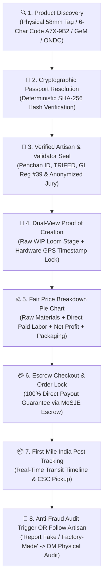

# Buyer & Institutional Procurement End-to-End Flow (MoSJE — SIH PS 26090)

> Complete step-by-step consumer, B2C retail, and Government (GeM) B2G buyer journey covering physical-to-digital shortcode resolution, cryptographic passport verification, the 4-part fair price breakdown pie chart, escrow checkout, logistics tracking, post-market anti-fraud audits, and judge pitch strategies.

---



---

## 1. Discovery & Access Channels

### 1.1 The 4 Real-World Discovery Channels
A conscious buyer or institutional officer encounters an authentic handcrafted Indian heritage craft through one of 4 channels:

1. **Physical 58mm Thermal Sticker**: Scanning the high-contrast printed QR code or reading the shortcode on the physical parcel tag.
2. **The "Zero-Hardware" Handwritten Shortcode**: Reading the handwritten code (e.g., `"Verify: artify.gov.in/A7X-9B2"`) tied with a string on cardboard.
3. **Government e-Marketplace (GeM)**: Institutional procurement officers purchasing GI-tagged handloom sarees or brassware for official ministry gifts.
4. **ONDC & WhatsApp Commerce**: Urban retail consumers browsing social commerce or Beckn marketplace apps.

### 1.2 User Action
- Buyer opens `https://artify.gov.in`, types **`A7X-9B2`** into the search bar, and clicks **"Verify Authenticity"** (or scans the QR code with any mobile camera).

---

## 2. Cryptographic Passport & Shortcode Resolution

### 2.1 Backend Execution
- **Endpoint**: `GET /api/v1/passport/code/A7X-9B2` (or `GET /api/v1/passport/verify/{hash}`)
- **QRService**:
  - Resolves shortcode `A7X-9B2` to immutable hash `e3b0c44298fc1c149afbf4c8996fb92427ae41e4649b934ca495991b7852b855`.
  - Re-computes SHA-256 digest over stored payload keys to ensure 100% tamper-evident integrity.
- **Response Time**: <35ms.

---

## 3. Public Digital Heritage Passport Experience

### 3.1 Verified Authenticity Banner
- **Header Badge**: `✅ MoSJE Verified Authentic Handloom`
- **GI Certificate Tag**: `🎖️ Geographical Indication: Banarasi Brocade & Saree (GI Reg #39)`
- **Verification Code**: `CODE: A7X-9B2`
- **Product Title**: *Handwoven Banarasi Katan Silk Saree with Zari Booti*

### 3.2 Master Artisan Profile & Validator Credentials
- **Artisan**: **Radha Devi** (Varanasi Handloom Cluster, Uttar Pradesh)
- **Official Registrations**:
  - Pehchan ID: `UP-VAR-102938`
  - TRIFED ID: `TRIFED-UP-7721`
  - MoSJE Certification: **PM-DAKSH Level 4 Certified Master Artisan**
- **Zero-Trust Validator Seal**:
  - *"Verified by Anonymized 3-Peer Cluster Jury (2/3 Quorum Consensus Confirmed)"*

---

## 4. Dual-View Proof of Creation & Dialect Audio Narrative

### 4.1 Proof of Creation (2-Step WIP vs Catalog View)
To protect buyers from factory-made wholesale fakes, the passport displays the physical journey:
- **The Catalog View**: Clean background portrait meeting e-commerce listing standards.
- **The Passport View**: The raw, unedited Work-In-Progress (WIP) photo showing the shuttle moving across the wooden loom.
- **Hardware GPS & Timestamp Lock**:
  - `📍 Geotagged: 25.3176° N, 82.9739° E (Varanasi Handloom Cluster)`
  - `🕒 Timestamp: 2026-09-08 10:30 UTC (Direct Camera Sensor Lock • Gallery Uploads Blocked)`

### 4.2 Interactive Native Dialect Audio Story
- Click-to-play streaming player of Radha Devi speaking in native Bhojpuri with English subtitle synchronization:
  > *"E saree hum apne parivarik katan resham kargha par 10 din mein tayyar kareeni. Har booti hath se bunaal ba..."*
- Establishes genuine emotional connection between urban buyer and rural artisan.

---

## 5. 100% Transparent Fair Price Breakdown (0% Middleman)

### 5.1 The Cost Breakdown Card (Buyer Transparency)
Urban buyers willingly pay premium prices when they see that 80%+ of their money goes directly to the artisan rather than middleman markups:

```
[ Fair Price Breakdown: ₹9,800 ]
  █ Raw Materials (Pure Silk & Zari) : ₹3,200 (32.6%)
  █ Direct Paid Labor to Artisan     : ₹4,800 (49.0%) [10 Days @ ₹480/day Floor]
  █ Direct Artisan Enterprise Profit : ₹1,500 (15.3%)
  █ Logistics & Packaging            : ₹300   (3.1%)
  ---------------------------------------------------
  TOTAL: ₹9,800  (Middleman Commission: ₹0.00 / 0%)
```

### 5.2 Social Impact Verification Seal
- Verified badge: *"🛡️ Certified by MoSJE: Zero middleman commission. 100% Direct-to-Jan-Dhan disbursement guaranteed."*

---

## 6. Checkout, Direct Payment & Smart Escrow Lock

### 6.1 Payment Channels
- **Retail Consumers**: Instant UPI deep link (`upi://pay?pa=artify.escrow@sbi&am=9800&tn=A7X-9B2`), Cards, or NetBanking.
- **Government Procurement (GeM)**: Automated L1 procurement PO issuance with HSN code `50072010`.

### 6.2 Escrow Security
- Funds are held in the **MoSJE Digital Escrow Account (State Bank of India)**.
- Disbursed instantly to the artisan's Jan Dhan account upon logistics handover.

---

## 7. First-Mile Shipping & Live India Post Tracking

### 7.1 Real-Time Transit Tracking
- Buyer tracks shipment in real time via `GET /api/v1/logistics/india-post/track/IP882910492IN`.
- **Milestone Timeline**:
  1. `LABEL_CREATED`: 58mm physical thermal label printed in Varanasi.
  2. `CSC_VLE_ACCEPTED`: Handed over at village CSC Rural Logistics Centre (PIN `221001`).
  3. `IN_TRANSIT`: Processed at Varanasi Central Sorting Facility.
  4. `OUT_FOR_DELIVERY`: Dispatched to delivery address in Delhi (PIN `110001`).

---

## 8. Unboxing Verification & Anti-Fraud Post-Market Audit

### 8.1 Delivery Re-Verification
- Upon receiving the package, the buyer scans the 58mm sticky label on the box to confirm the product hash matches the delivered item.

### 8.2 The "Report Fake / Factory-Made" Post-Market Audit Trigger
The end-consumer acts as the ultimate auditor in the Zero-Trust architecture:
- If the buyer tests the fabric and suspects machine-made powerloom polyester synthetic fabric:
  1. Clicks **"🚩 Report Fake / Factory-Made"**.
  2. Selects reason: *"Machine-made powerloom polyester sold as authentic handloom GI craft"*.
  3. Uploads optional evidence photo.
  4. Clicks **Submit Report**.
- **Backend Action (`POST /api/v1/verify/report-fake`)**:
  - Incident `rep_antifraud_5541` is created.
  - Automatically alerts the **District Magistrate / MoSJE Nodal Officer** for a physical audit.
  - System traces back to the specific anonymized peer jurors who approved the item, slashing their Trust Score and freezing government welfare access if collusion is found.

### 8.3 Repeat Patronage & Follow Artisan Loop
- **Direct Gratitude**: Buyer sends a digital thank-you note that is converted to spoken dialect voice message for Radha Devi.
- **Follow Master Artisan**: Buyer clicks **"Follow Radha Devi"** to receive seasonal festival alerts on WhatsApp for limited-edition Diwali and Durga Puja masterworks.
- **Festive Pre-Orders**: Buyer can place direct customized advance orders with guaranteed artisan fair wages.

---

## 🎤 Winning Pitch Defense for Judges (Buyer & Market Side)

### Q1: "Why would an urban buyer pay ₹9,800 for this saree when they can buy a similar-looking powerloom saree on Amazon for ₹2,500?"
> *"Sir/Ma'am, urban consumers and institutional buyers on GeM are already looking for authentic heritage and GI-tagged goods, but they suffer from trust deficit—counterfeits make up over 60% of the handloom market. Artify Bharat solves this trust crisis with Proof of Creation (raw WIP loom photos, hardware GPS lock, and native dialect audio narrative).*
> 
> *Furthermore, our Fair Price Breakdown shows the buyer that ₹6,300 of their ₹9,800 is going directly into Radha Devi's Jan Dhan account. Conscious consumers happily pay a premium when authenticity is cryptographically proven and social impact is 100% transparent."*

### Q2: "What if a buyer maliciously clicks 'Report Fake' just to get a refund or harass an artisan?"
> *"Sir/Ma'am, a single report does not penalize an artisan. The 'Report Fake' trigger dispatches a physical verification ticket to the MoSJE District Magistrate queue and assigns 3 independent cluster master jurors to inspect the loom. The system requires physical sample testing (burn test for pure silk/zari) before any punitive action is taken. This ensures protection against malicious buyer abuse while maintaining strict anti-counterfeit deterrence."*
