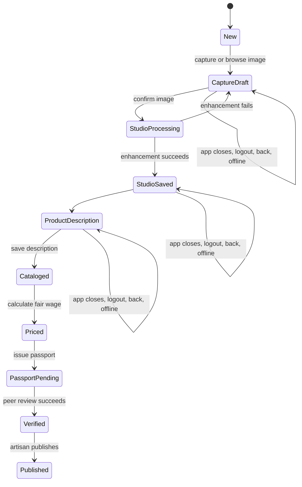

# Artify Bharat Frontend Product Workflow

## Purpose

This document defines how the Artify Bharat frontend should work for artisans, buyers, and administrators. It combines the current React web application behavior with the required production workflow:

- Clean, simple UI with low cognitive load.
- Voice-first artisan onboarding with an optional manual form.
- Government artisan identity verification before a profile becomes trusted.
- Strict account isolation so one artisan cannot access another artisan's private data.
- Product capture, AI Studio enhancement, voice catalog description, pricing, passport, and listing.
- Offline and resume support so closing the app, logging out, or losing connectivity does not force repeated work.
- Public buyer visibility only for products that the artisan has explicitly cataloged and published.

The frontend is an assistive workflow. The backend remains authoritative for authentication, authorization, product ownership, verification, catalog persistence, pricing, and public visibility.

## Product Principles

1. **Simple first screen**: show the next useful action, not every feature at once.
2. **Voice first, manual always available**: voice reduces literacy barriers; manual entry is an equal fallback.
3. **One product, one resumable workflow**: every stage is saved locally and remotely where possible.
4. **No silent failure**: errors state what happened and what the artisan should do next.
5. **Private by default**: drafts and profile data are visible only to the owning artisan.
6. **Public by approval**: buyers and other artisans see only cataloged/published products.
7. **Preserve authenticity**: Studio enhancement may clean and normalize an image but must not generate or hallucinate craft details.
8. **Progressive disclosure**: advanced controls such as pricing, exports, passports, and jury status appear after the product basics are complete.

## Technology Baseline

- React 19, TypeScript, Vite, React Router.
- Tailwind CSS and shared UI components.
- FastAPI backend with SQLAlchemy and Pydantic.
- Browser APIs: MediaDevices, MediaRecorder, Geolocation, DeviceOrientation, IndexedDB, Service Worker, Web Bluetooth, and Web Share where supported.
- Bhashini: regional speech recognition and translation.
- Ollama/Mistral: structured product-description generation.
- OpenCV/rembg or GrabCut: non-generative image enhancement.
- Local draft storage: IndexedDB.
- Remote persistence: authenticated API requests with bearer tokens.

## Roles and Visibility

### Artisan

An authenticated artisan may:

- Create and edit their own artisan profile.
- Create product drafts owned by their artisan ID.
- Capture or browse product images while the temporary browse option is enabled.
- Run images through AI Studio.
- Generate and edit product descriptions with voice or manual entry.
- Set pricing, generate a Heritage Passport, print tags, and publish a listing.
- Resume their own incomplete workflows after logout, reload, app close, or network loss.

An artisan must not be able to:

- Read another artisan's private profile.
- Edit another artisan's product.
- See another artisan's unlisted draft.
- Use a local draft ID as an authorization identity.

### Buyer and Public Visitor

A buyer or public visitor may:

- Browse products explicitly cataloged/published for public visibility.
- View the enhanced product image, description, fair-price breakdown, artisan origin, and verification status.
- Verify a passport using a shortcode or hash.
- Report a suspected fake product.

A buyer must not see:

- Artisan PINs, tokens, private phone data, or private government identifiers.
- Unfinished product drafts.
- Raw internal storage paths.
- Products that have not passed the required catalog/publication state.

### Administrator

Administrators may have cross-artisan operational visibility according to backend role permissions. The frontend must not infer administrator authority from local storage; the backend JWT role and authorization rules are authoritative.

## Artisan Onboarding

### Entry

The landing page presents two distinct paths:

- **Artisan Login** for an existing account.
- **Create Artisan Account** for first-time onboarding.

An unauthenticated visitor must not see the private artisan portal. `/artisan` redirects to the landing page unless a valid session exists. The signup route may be opened explicitly, for example `/artisan?signup=1`.

### Voice-first signup

1. Select language or dialect.
2. Record an onboarding voice story.
3. Bhashini transcribes and translates the speech.
4. Ollama/Mistral extracts known profile fields without inventing missing values.
5. Show a short review of extracted values.
6. Ask for required security fields that voice cannot safely establish, including phone and PIN.
7. Ask for a government artisan identifier.
8. Verify the identifier against the backend registry.
9. Create the artisan account only after validation succeeds.
10. Store the returned session and route to the artisan dashboard.

### Manual signup

The user may switch to a manual form at any point. The manual path must collect the same required data as the voice path:

- Name.
- Phone number.
- PIN.
- Dialect.
- Craft type.
- Government artisan ID type and value.
- State, district, and cluster when not returned by verification.

Manual entry is not a lower-security path. It must use the same backend identity verification and account-ownership rules.

### Government identity verification

Supported identity sources may include:

- Pehchan ID.
- TRIFED ID.
- e-Shram UAN.
- PM-SURAJ or PM-DAKSH references when supported by the backend.

The frontend displays only the minimum verification result needed by the artisan. Sensitive identifiers must not be written to console logs, URL parameters, public catalog records, or uncontrolled IndexedDB fields.

## Authentication and Session Rules

- Store the access token according to the production security policy. Prefer secure HttpOnly cookies for production; bearer local storage is acceptable only for the current development implementation and must be replaced before deployment.
- Store a minimal session record containing artisan ID, display name, phone display value, and role.
- Never use phone number, display name, or local draft ID as an authorization key.
- Every private API request sends the access token.
- Every backend private endpoint derives the effective artisan ID from the authenticated principal and checks ownership.
- Logout must remove the session token and session record, broadcast an auth-change event, clear private in-memory state, and navigate to the public landing page.
- A mounted artisan portal must not continue displaying profile or product state after logout.
- An expired or rejected token must clear private state and require login again.

## Artisan Dashboard

The authenticated dashboard should be intentionally quiet and action-oriented.

Primary actions:

- Add product.
- Continue saved work.
- View my products.
- Record a voice story.
- Open offline drafts.

Secondary actions:

- Fair Wage Engine.
- Heritage Passport.
- Print tag.
- Payout and orders.
- Account/profile settings.

The dashboard may show public catalog listings separately, but must label them as public products and must not mix them with the artisan's private drafts.

## Product Workflow State Machine

### Required state fields

Each workflow checkpoint should include:

- Local draft ID.
- Backend product ID, once the backend creates a product.
- Owning artisan ID.
- Product title.
- Current workflow step.
- GPS coordinates and provenance timestamp when available.
- Original capture reference.
- Enhanced image URLs or local data references.
- Voice recording reference when available.
- Description fields and last generated result.
- Sync status and last updated timestamp.
- Error state that can be retried.

A local draft ID is never sent as a backend product ID. The frontend must persist and restore the backend UUID returned by product creation.

## Camera and Browse Capture

### Capture behavior

- Camera view uses a square framing guide and orientation feedback.
- GPS and timestamp are attached when available.
- The current development web flow may allow Browse image as a temporary option.
- The product image is saved locally immediately after capture or browse selection.
- `Save draft & exit` explicitly returns to the dashboard.
- Back navigation also preserves the draft; it must not silently discard the image.
- Retake affects only the current unsaved capture.

### Resume behavior

When the artisan returns:

- Capture-only drafts reopen in Camera Studio with the captured image already visible.
- Enhanced drafts reopen in AI Studio with the original and enhanced images.
- Description drafts reopen in Product Description with all enhanced images and generated/manual fields.
- The exact workflow checkpoint draft is preferred over the newest unrelated draft.

## AI Studio

AI Studio is non-generative and must expose clear status without overwhelming the artisan.

Pipeline:

1. Decode and validate the image.
2. Calculate visual complexity for downstream pricing.
3. Apply CLAHE lighting equalization.
4. Remove the background with rembg/U-2-Net where available, otherwise GrabCut fallback.
5. Composite on a neutral studio background.
6. Crop to a 1:1 output.
7. Save raw and enhanced media.
8. Return the backend product ID and pipeline metadata.

For every image:

- Show `Enhancing`, `Enhanced and saved`, or `Failed`.
- Do not enable Continue while any image is processing.
- Allow retry of failed images without recapturing successful images.
- Persist each successful enhanced result immediately.
- Never claim that an image is saved unless the backend response confirms it.

## Product Description Page

Product Description is a separate page from Artisan Profile.

The page contains:

- All enhanced product images.
- Primary image marker.
- Product title.
- Craft type.
- Material.
- Product description.
- Labor days.
- Voice action.
- Manual editing controls.
- Save and list action.

### Voice description flow

1. Artisan selects a dialect.
2. Artisan records a product story.
3. Bhashini performs regional speech recognition and translation.
4. Ollama/Mistral creates a product title, description, craft category, material, estimated labor days, and tags.
5. The frontend shows a concise success state and the generated description.
6. The generated fields populate the editable product form.
7. The artisan may correct any field before saving.

The interface should not force the artisan to read raw transcripts or technical extraction details. Technical diagnostics belong in logs or an optional advanced view.

If Ollama is unavailable:

- Show: `Ollama is not available. Start Ollama and try the product description again.`
- Preserve the audio locally.
- Keep the form usable for manual entry.
- Provide a retry action without requiring another recording.

## Catalog Save and Public Listing

Saving a description must be a real backend operation, not only a React state update.

1. Send the backend product UUID and edited catalog fields.
2. Backend verifies product ownership from the JWT.
3. Backend updates title, description, category, tags, and status.
4. Product becomes `cataloged`.
5. Frontend refreshes the artisan-site listing.
6. The dashboard shows the product as listed.
7. Public/buyer APIs return only products allowed by the publication policy.

The enhanced image URL returned to browsers must be a safe media URL such as `/media/enhanced/<filename>`, never an internal filesystem path.

## Offline and Resume Storage

IndexedDB is used for local recovery, not authorization.

Store locally:

- Capture preview.
- Enhanced media references or blobs required for recovery.
- Product title and editable fields.
- Current step.
- Sync status.
- Non-sensitive GPS/provenance information required for the draft.

Do not store:

- Plaintext PINs.
- Access tokens in uncontrolled draft records.
- Full government identifiers unless the security design explicitly permits encrypted storage.
- Another artisan's draft under the current artisan key.

When network returns, sync queued operations idempotently. A retry must not create duplicate products or duplicate media records.

## Buyer Experience

The buyer experience is public-facing and separate from private artisan editing.

A buyer product page should show:

- Enhanced product images.
- Product title and description.
- Craft category and material.
- Artisan display identity and cluster.
- Transparent fair-price breakdown.
- Heritage Passport and shortcode.
- Verification status.
- WIP/provenance evidence only when publication policy allows it.
- Report Fake action.

A buyer must never see the artisan's PIN, private phone number, internal draft IDs, or unverified private notes.

## Error and Recovery Rules

Every async operation needs four states:

- Idle.
- Loading.
- Success.
- Recoverable error.

Required recoverable actions:

- Login 401: explain incorrect credentials or missing account and link to signup.
- Ollama unavailable: preserve audio and offer retry.
- Studio failure: preserve original image and retry enhancement.
- Network failure: save locally and show offline status.
- Backend product not found: do not PATCH a local draft ID; ask the user to resume/re-enhance or map the saved backend UUID.
- Logout: clear private UI state immediately.

## Security Checklist

- [ ] Backend verifies JWT on every private product/profile mutation.
- [ ] Backend compares product owner with authenticated artisan ID.
- [ ] Admin cross-artisan access is role-based on the backend.
- [ ] Public listing endpoint exposes only approved catalog states.
- [ ] Frontend route guards protect `/artisan`.
- [ ] Logout clears in-memory state, session state, and navigation context.
- [ ] Local draft IDs cannot authorize API requests.
- [ ] Error messages do not expose secrets or internal filesystem paths.
- [ ] Government identifiers are masked and excluded from public payloads.
- [ ] Product media URLs are safe browser routes, not local absolute paths.
- [ ] Upload validation limits file type, file size, and decoded dimensions.
- [ ] Catalog save is idempotent and tied to a backend product UUID.

## Accessibility and UI Quality

- Use large touch targets, readable labels, and high contrast.
- Keep one primary action per screen.
- Use icon plus text for unfamiliar actions.
- Never rely on color alone for status.
- Provide keyboard and screen-reader labels.
- Preserve layout on small screens; do not allow buttons or long translations to overlap.
- Use plain language for artisan-facing errors.
- Keep technical terms such as Bhashini, Ollama, CLAHE, and U-2-Net out of the primary action copy unless the user opens technical details.
- Avoid decorative complexity that competes with the next action.

## Implementation Mapping

| Concern | Frontend surface | Backend surface |
|---|---|---|
| Login/register | `LandingPage`, `authApi` | `/api/v1/auth/register`, `/api/v1/auth/login` |
| Artisan profile | `VoiceRecorder`, `VoiceProfileForm` | auth and catalog services |
| Camera/browse capture | `CameraStudio` | `/api/v1/studio/enhance` |
| AI Studio | `StudioEnhancement` | CV service and media storage |
| Product description | `ProductDescriptionStep` | `/api/v1/catalog/voice`, catalog update endpoint |
| Draft recovery | IndexedDB service and workflow checkpoint | optional sync APIs |
| Artisan listings | dashboard listing section | `/api/v1/catalog/listings` |
| Private inventory | artisan dashboard | `/api/v1/catalog/my-inventory` |
| Buyer verification | `BuyerPortalPage` | passport and verification endpoints |
| Pricing | `FairWageSlider` | pricing service |
| Thermal tag | `ThermalPrintPreview` | QR/passport service |

## Definition of Done

A production-ready frontend flow is complete only when:

1. A first-time artisan can onboard by voice or manual form.
2. Government identity verification is required before a trusted profile is created.
3. A logged-out visitor cannot see private artisan content.
4. An authenticated artisan can create only their own products.
5. Capture and enhancement survive navigation, logout, reload, and network loss.
6. Every enhanced image is saved and recoverable.
7. Voice description uses Bhashini and Ollama when configured, with manual fallback.
8. Product save persists to the backend using the real product UUID.
9. Cataloged products appear in the intended artisan/public listing with correct visibility.
10. Buyers see only approved public product information.
11. Frontend build, type checks, backend tests, and relevant end-to-end flows pass.
