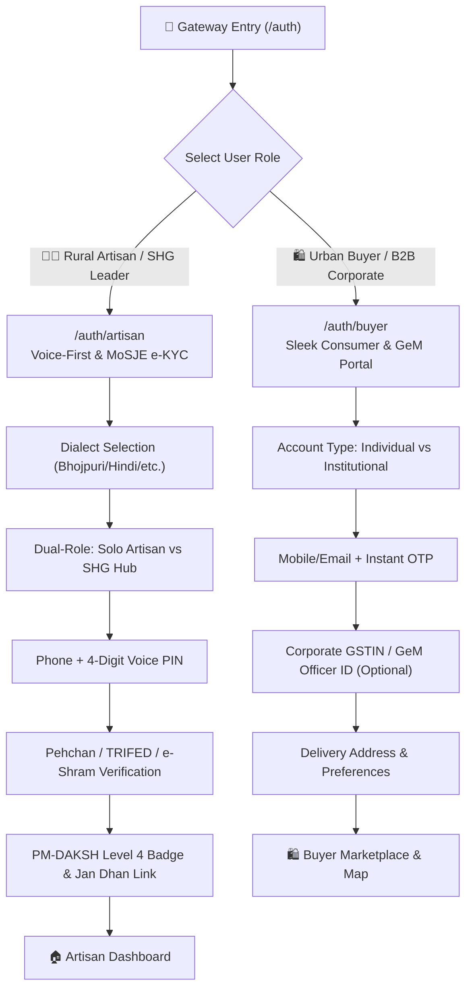
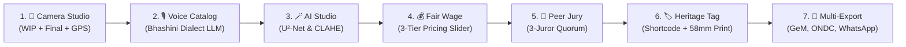

# 🎨 Artify Bharat — Master Frontend UI/UX & Feature Specification

> **Smart India Hackathon (SIH 2024 - PS 26090)**  
> **Ministry of Social Justice and Empowerment (MoSJE)**  
> **Comprehensive Page-by-Page Layout, Dual-Role Onboarding (Artisan vs Buyer), 7-Step Product Studio, Native Web APIs & System Architecture**

---

## 📑 Table of Contents

1. [Executive Summary & Design Philosophy](#1-executive-summary--design-philosophy)
2. [Universal Design System, Colors & Typography](#2-universal-design-system-colors--typography)
3. [Native Browser APIs & Offline-First PWA Architecture](#3-native-browser-apis--offline-first-pwa-architecture)
4. [Dual-Role Authentication & Onboarding Specifications](#4-dual-role-authentication--onboarding-specifications)
   - [4.1 Artisan & SHG Aggregator Onboarding (`/auth/artisan`)](#41-artisan--shg-aggregator-onboarding-authartisan)
   - [4.2 Buyer & Institutional Procurement Onboarding (`/auth/buyer`)](#42-buyer--institutional-procurement-onboarding-authbuyer)
5. [Page-by-Page Detailed UI/UX Specifications](#5-page-by-page-detailed-uiux-specifications)
   - [Page 1: Landing Page / Heritage Portal Gateway (`/`)](#page-1-landing-page--heritage-portal-gateway-)
   - [Page 2: Role Selection Hub (`/auth`)](#page-2-role-selection-hub-auth)
   - [Page 3: Artisan Dashboard & Offline Hub (`/artisan/dashboard`)](#page-3-artisan-dashboard--offline-hub-artisandashboard)
   - [Page 4: 7-Step New Product Studio & Verification Wizard (`/artisan/new-product`)](#page-4-7-step-new-product-studio--verification-wizard-artisannew-product)
   - [Page 5: Zero-Trust Peer Review Jury Portal (`/artisan/jury`)](#page-5-zero-trust-peer-review-jury-portal-artisanjury)
   - [Page 6: Artisan Inventory & Jan Dhan Escrow Payouts (`/artisan/inventory`, `/artisan/payouts`)](#page-6-artisan-inventory--jan-dhan-escrow-payouts-artisaninventory-artisanpayouts)
   - [Page 7: Buyer Marketplace & Heritage Cluster Map (`/marketplace`, `/explore`)](#page-7-buyer-marketplace--heritage-cluster-map-marketplace-explore)
   - [Page 8: Product Detail Page (PDP) & Authenticity Verification (`/product/:id`)](#page-8-product-detail-page-pdp--authenticity-verification-productid)
   - [Page 9: Public Heritage Passport Verification Portal (`/passport/:shortcode`, `/verify/:hash`)](#page-9-public-heritage-passport-verification-portal-passportshortcode-verifyhash)
   - [Page 10: Escrow Checkout & Order Confirmation (`/checkout`, `/order/:order_id`)](#page-10-escrow-checkout--order-confirmation-checkout-orderorder_id)
   - [Page 11: Real-Time Order & India Post Dispatch Tracker (`/orders/track/:order_id`)](#page-11-real-time-order--india-post-dispatch-tracker-orderstrackorder_id)
   - [Page 12: MoSJE / District Magistrate Cluster Heatmap & Audit Dashboard (`/admin/dashboard`)](#page-12-mosje--district-magistrate-cluster-heatmap--audit-dashboard-admindashboard)
6. [Frontend Component Hierarchy & State Management](#6-frontend-component-hierarchy--state-management)
7. [API Client & Service Layer Integration Matrix](#7-api-client--service-layer-integration-matrix)

---

## 1. Executive Summary & Design Philosophy

Artify Bharat is a dual-interface progressive web application engineered to bridge the digital and economic divide for **20+ million rural Indian artisans and handloom weavers** while providing **urban buyers and government procurement officers** with indisputable cryptographic proof of authenticity.

### Key Architectural Pillars:
1. **Zero-App-Store Friction**: 100% browser-native Responsive Web App (React / Next.js / Tailwind CSS / TypeScript) running smoothly on low-end ₹4,000 Android smartphones, tablets, and desktop browsers.
2. **Zero-Literacy Voice-First UX**: Illiterate and semi-literate artisans navigate through spoken audio in 7+ Indic dialects (Bhojpuri, Maithili, Awadhi, Hindi, Tamil, Bengali, Kashmiri) powered by Bhashini AI and Web Speech API.
3. **Hardware-Locked Authenticity**: Work-In-Progress (WIP) and final photos are locked directly to hardware camera sensors with live GPS geofencing and timestamps—blocking gallery uploads and factory counterfeits.
4. **Statutory Fair Wage Guarantee**: Dynamic pricing algorithms enforce state-wise statutory minimum daily wages ($\ge ₹450$/day) and transparently reveal cost structures to buyers.
5. **Decentralized Zero-Trust Verification**: Automated 3-peer jury quorum, deterministic SHA-256 cryptographic passports, 6-character physical shortcodes (`A7X-9B2`), and 58mm Web Bluetooth thermal sticker printing.

---

## 2. Universal Design System, Colors & Typography

The design system merges traditional Indian handicraft aesthetics (Terracotta, Raw Silk, Indigo) with modern glassmorphism and WCAG AAA accessible high-contrast interfaces.

### 🎨 Color Palette Tokens

```css
:root {
  /* Heritage Primary Colors */
  --color-terracotta: #C04A26;        /* Primary Brand Accent (Clay & Terracotta) */
  --color-terracotta-dark: #9E381A;   /* Primary Hover / Active */
  --color-raw-silk: #FDFBF7;          /* App Background / Light Canvas */
  --color-silk-card: #FFFFFF;         /* Pure Card Canvas */
  --color-trust-green: #15803D;       /* Verified Stamp / Success / Wage Realized */
  --color-trust-green-light: #DCFCE7; /* Success Tint / Badge Background */
  --color-deep-indigo: #0F172A;       /* Primary Typography / Slate Background */
  --color-marigold-gold: #D97706;     /* GI Certified / PM-DAKSH Badges */
  --color-alert-crimson: #DC2626;     /* Counterfeit Flag / Error State */
  
  /* Glassmorphism & Elevation */
  --glass-bg: rgba(255, 255, 255, 0.85);
  --glass-border: rgba(203, 213, 225, 0.4);
  --glass-shadow: 0 8px 32px 0 rgba(15, 23, 42, 0.08);
  --radius-lg: 16px;
  --radius-md: 12px;
  --radius-full: 9999px;
}
```

### 🔤 Typography & Contrast Hierarchy
- **Primary Headings**: `Rozha One` / `Cinzel` / `Outfit` (Heritage Display & Modern Sans)
- **Body & Numerics**: `Plus Jakarta Sans` / `Inter` (Optimized for micro-screens & legibility)
- **Indic Dialect Script**: `Noto Sans Devanagari`, `Noto Sans Tamil`, `Noto Nastaliq Urdu`
- **Touch Target Sizes**: Minimum `48px × 48px` for all interactive elements in Artisan mode, with high tactile haptic/audio feedback.

---

## 3. Native Browser APIs & Offline-First PWA Architecture

The application utilizes 8 native browser APIs without requiring native Android APK or iOS app store downloads:

| Web API | Browser Feature | Purpose in Artify Bharat |
|---|---|---|
| **MediaDevices API** | `navigator.mediaDevices.getUserMedia` | Hardware camera capture for WIP & final photos; gallery file uploads strictly disabled |
| **Geolocation API** | `navigator.geolocation.getCurrentPosition` | Captures GPS coords ($Lat, Long$) for hardware tamper-proof cluster verification |
| **DeviceOrientation API** | `window.addEventListener('deviceorientation')` | Gyroscope leveling indicator ensuring straight, well-framed craft portraits |
| **Web Speech / Audio API** | `SpeechRecognition` & `AudioContext` | Zero-literacy dialect speech-to-text and "Ask Dadi" audio streaming |
| **Web Bluetooth API** | `navigator.bluetooth.requestDevice` | Direct browser-to-58mm ESC/POS thermal printer bridge for physical parcel stickers |
| **IndexedDB API** | `window.indexedDB` (Dexie.js / Native) | Offline storage for product drafts, voice memos, and offline shortcode queue |
| **Background Sync API** | `ServiceWorkerRegistration.sync` | Auto-syncs drafts and transactions when mobile reconnects to 2G/3G/4G network |
| **Web Share API** | `navigator.share` | 1-tap WhatsApp, Telegram, and SMS sharing of verified heritage passports |

---

## 4. Dual-Role Authentication & Onboarding Specifications

The platform provides two distinctly customized onboarding pathways:



---

### 4.1 Artisan & SHG Aggregator Onboarding (`/auth/artisan`)

#### 🎯 Target Persona:
Solo craftsperson (e.g., *Radha Devi*, Varanasi Weaver) or SHG Leader managing 20+ village artisans.

#### 📱 Layout & Screen Sections:
1. **Audio Welcome Header**:
   - Floating animated "Dadi" avatar speaking in dialect: *"Namaste! Artify Bharat mein aapka swagat hai. Apna pehchan chunein."*
   - Speaker volume mute/unmute toggle.
2. **Step 1: Dialect Selection Grid**:
   - 8 Large Visual Dialect Cards:
     - 🪷 **Bhojpuri (भोजपुरी)** • 🕉️ **Hindi (हिन्दी)** • 🌾 **Maithili (मैथिली)** • 🦚 **Awadhi (अवधी)**
     - 🪁 **Gujarati (ગુજરાતી)** • 🏛️ **Tamil (தமிழ்)** • ❄️ **Kashmiri (کٲشُر)** • 🎨 **Bengali (বাংলা)**
   - Selecting a dialect immediately re-voices the entire UI in that audio stream.
3. **Step 2: Operating Mode Toggle**:
   - Card A: **🧑🎨 Solo Artisan Mode** (*Main akela karigar hoon*)
   - Card B: **👥 SHG Leader / Aggregator Hub Mode** (*Main Samuh/SHG ka leader hoon — 10-50 karigaron ka prabandhan*)
4. **Step 3: Phone & 4-Digit Security PIN**:
   - Large numeric keypad with auditory digit pronunciation (e.g., speaking "Chaar", "Do", "Ek").
   - 10-digit mobile number input.
   - 4-digit PIN setup (e.g., `4421`) for passwordless, zero-literacy daily login.
5. **Step 4: MoSJE Government DPI e-KYC**:
   - **Voice or OCR Input** for official IDs:
     - 🪪 **Pehchan ID**: (e.g., `UP-VAR-102938`)
     - 🌲 **TRIFED ID**: (e.g., `TRIFED-UP-7721`)
     - 📜 **12-Digit e-Shram UAN**: (e.g., `1234-5678-9012`)
   - Instant live lookup against backend registries:
     - Fetches verified Name, State, District, and Handloom Cluster.
     - Retrieves **PM-DAKSH Master Skill Level** (Level 4 Certified) and **PM-SURAJ** credit eligibility.
     - Automatically locks Bank Account (PM Jan Dhan account) for direct escrow payouts.
6. **Step 5: Completion & Haptic Confirmation**:
   - Green verified stamp animation with celebratory chime.
   - Saves session token into secure `HttpOnly` cookie and indexed offline token store.

---

### 4.2 Buyer & Institutional Procurement Onboarding (`/auth/buyer`)

#### 🎯 Target Persona:
Conscious urban retail buyer, boutique interior designer, or Government Institutional Procurement Officer purchasing GI gifts via GeM.

#### 📱 Layout & Screen Sections:
1. **Modern Sleek Header**:
   - Brand logo with tagline: *"Direct from the Weaver's Loom to Your Doorstep • 100% Verified GI Heritage"*.
2. **Account Type Toggle Tabs**:
   - Tab 1: **👤 Individual Conscious Buyer** (Retail, Gift, Home Decor)
   - Tab 2: **🏢 B2B / Corporate / GeM Institutional Officer** (Bulk Orders, Govt Procurement)
3. **Authentication Fields**:
   - Mobile Number or Work Email.
   - Instant 6-digit OTP delivery (SMS/WhatsApp).
   - Social Auth (Google 1-Tap / Apple ID).
4. **B2B / GeM Officer Specific Fields** (Only when Tab 2 is active):
   - Company / Ministry Name (e.g., *Ministry of External Affairs / Tata Heritage Retail*).
   - GSTIN Number with auto-validation.
   - GeM Buyer ID & Official Designation.
5. **Delivery Address & Preferences**:
   - PIN Code auto-fill (District, State, City).
   - Preferred craft categories (Handloom Sarees, Madhubani Art, Brass Metalware, Pashmina Shawls).
6. **CTA**:
   - High-contrast button: **"Start Exploring Authentic Bharat"**.

---

## 5. Page-by-Page Detailed UI/UX Specifications

---

### Page 1: Landing Page / Heritage Portal Gateway (`/`)

#### 🎨 Hero Section:
- **Visual**: High-resolution video background of a Varanasi master weaver operating a traditional wooden pit-loom.
- **Header Navigation**:
  - Logo: **Artify Bharat** (with Ashoka Emblem & MoSJE badge).
  - Navigation links: *Explore Crafts*, *GI Map of India*, *Verify Passport*, *About MoSJE Mission*.
  - Language Switcher (12 languages).
  - Dual Auth Button: *Login as Artisan* / *Buyer Sign In*.
- **Hero Title**: *"Direct from the Master Artisan's Loom — Protected by Zero-Trust AI & Cryptography"*.
- **Instant Shortcode Verification Widget**:
  - Prominent search input with camera QR scanner icon:
    `[ Enter 6-Char Shortcode e.g. A7X-9B2 ] [ 🔍 Verify Authenticity ]`
  - Instantly takes the user to the tamper-proof Heritage Passport without logging in.
- **Dual Action Cards**:
  - Card 1 (Artisan): *"Are you a Weaver or Craftsman? List your product via Voice in 2 minutes & get direct Jan Dhan payouts."* -> **[ Main Karigar Hoon ]**
  - Card 2 (Buyer): *"Explore authentic GI-certified crafts directly from certified rural clusters."* -> **[ Shop Authentic Crafts ]**

#### 🗺️ Interactive Live Impact Counter & Cluster Map:
- **Live Statistics**:
  - `₹4.2 Cr+` Direct Fair Wages Paid
  - `48,200+` Master Artisans Verified
  - `142+` Geographical Indication (GI) Clusters Connected
  - `0%` Middleman Deductions
- **Interactive Leaflet/Mapbox GIS Map of India**:
  - Pulsing clusters (Varanasi Silk, Mithila Madhubani, Kutch Rogan Art, Bastar Dhokra Brass, Kashmir Pashmina).

---

### Page 2: Role Selection Hub (`/auth`)

- **Screen Layout**: High-contrast split screen or vertical cards on mobile.
- **Left / Top Card (Artisan)**:
  - Illustrated with a handloom shuttle and microphone.
  - Heading: **"Karigar / Bunkar Login" (कारीगर / बुनकर)**
  - Subtitle: *Voice-assisted cataloging, fair pricing, and direct bank settlement*.
  - Primary Button: *Aage Badhein (Proceed)* -> `/auth/artisan`.
- **Right / Bottom Card (Buyer)**:
  - Illustrated with a shopping bag and cryptographic verified badge.
  - Heading: **"Buyer / Consumer / GeM Officer"**
  - Subtitle: *Verified provenance, zero counterfeits, and transparent pricing*.
  - Primary Button: *Explore & Buy* -> `/auth/buyer`.

---

### Page 3: Artisan Dashboard & Offline Hub (`/artisan/dashboard`)

#### 📱 Header & Artisan Profile Banner:
- **Profile Card**:
  - Avatar / Initials: *RD* (Radha Devi)
  - Name & Cluster: **Radha Devi** • *Varanasi Handloom Cluster, UP*
  - Badges: `🎖️ Pehchan: UP-VAR-102938` • `✅ PM-DAKSH Level 4 Master Weaver`
  - Network Indicator: 🟢 *Online (4G)* / 🟡 *Offline (IndexedDB Mode Active)*
- **Spoken Audio Assistant Banner ("Ask Dadi")**:
  - Floating pill: *"Dadi se poochhein: Naya utpad kaise catalog karein?"* [🎙️ Tap to Speak]

#### 🚀 Primary Action Button:
- Massive, high-contrast Terracotta Button:
  **`[ ➕ Naya Utpad Jodein / Add New Product ]`**
  - Triggers the 7-Step New Product Creation Studio.

#### 📊 Metric Cards (Artisan Business Summary):
1. **Total Direct Earnings**: `₹38,450` *(Transferred directly to Jan Dhan A/c)*
2. **Active Verified Listings**: `14 Items`
3. **Pending Peer Jury Reviews**: `2 Items` *(Quorum: 2/3 Votes in Progress)*
4. **Orders to Dispatch**: `3 Parcels` *(CSC Drop-off PIN Ready)*

#### 📂 Offline Drafts Carousel (IndexedDB):
- Shows products photographed offline without internet connectivity.
- Displays: Thumbnail, Draft Name, Timestamp, Sync Status (`Ready to Sync`).
- Action: `[ 🔄 Auto-Sync All Drafts ]` (Activates Service Worker background sync).

#### 🎓 Learn & Earn / PM-DAKSH Micro-Reels:
- 30-second vertical video reels:
  - *“How to position your mobile camera for perfect saree border lighting”*
  - *“Understanding GI tag benefits & market price trends in 2026”*
  - Earn ₹50 credit reward upon completing each skill module.

---

### Page 4: 7-Step New Product Studio & Verification Wizard (`/artisan/new-product`)



---

#### 📸 Step 1: Authenticity Camera Studio
- **Full-Screen Viewport**: 1:1 square aspect ratio framing.
- **Hardware Sensor Lock**:
  - Live video feed via `navigator.mediaDevices.getUserMedia`.
  - **Zero Gallery File Uploads**: File input `<input type="file">` is intentionally blocked to prevent downloading stock photos of factory replicas.
- **Gyroscope Leveling Indicator**:
  - A subtle golden crosshair turns vibrant green when the artisan holds the camera at a level horizontal plane (using `DeviceOrientationAPI`).
- **Dual-Capture Tabs**:
  - **Tab A: Raw Work-In-Progress (WIP) Loom Photo**: Shows shuttle on the loom, raw clay on the potter's wheel, or hand-embroidery hoop.
  - **Tab B: Final Completed Product Photo**: Shows full item portrait.
- **Hardware Metadata Lock Overlay**:
  - Automatically captures and embeds GPS coordinates (`25.3176° N, 82.9739° E`) and ISO-8601 UTC timestamp.
- **Actions**:
  - `[ 🔄 Flip Camera ]`
  - `[ 📸 Capture Photo ]` (Triggers haptic vibration & shutter click).

---

#### 🎙️ Step 2: Zero-Literacy Voice Cataloging & AI Parsing
- **Visual Waveform Canvas**: Real-time microphone audio visualizer.
- **Spoken Prompt by Dadi**:
  > *"Apne utpad ke baare mein batayein — kya banaya hai, kitna samay laga, aur kacha maal kitne ka tha?"*
- **Recording Controls**:
  - Large red microphone button: `[ 🎙️ Bolna Shuru Karein (Start Speaking) ]`.
  - Dialect selector toggle (Bhojpuri / Hindi / Maithili / etc.).
- **Real-Time Speech-to-Text & LLM Structured Schema Extraction**:
  - As the artisan speaks, Mistral LLM / Bhashini translates and parses the audio into structured JSON:
    - **Product Title**: *Handwoven Banarasi Katan Silk Saree*
    - **Craft Category**: *Handloom Weaving*
    - **Raw Materials**: *Pure Mulberry Katan Silk, Gold Zari Thread*
    - **Raw Material Cost**: `₹3,200`
    - **Weaving Time**: `10 Days (80 Hours)`
    - **GI Classification**: *Banarasi Brocade & Saree (GI Reg #39)*
- **Editable Tag Badges**: Artisan can tap on any extracted tag to re-speak or adjust values.

---

#### 🪄 Step 3: Non-Generative AI Image Enhancement Studio
- **Before / After Comparison Slider**:
  - Split-screen slider allowing artisan to drag between the raw camera photo and the enhanced studio portrait.
- **Non-Generative AI Pipelines**:
  1. **Background Isolation (`U²-Net`)**: Removes cluttered village room backgrounds and replaces them with a clean studio neutral background (`#FDFBF7`).
  2. **Color Equalization (`OpenCV CLAHE` in LAB Color Space)**: Corrects yellow incandescent room lighting to true natural daylight dye colors without synthetic hallucination.
- **Authenticity Preservation Guarantee**:
  - A watermark badge shows: *"Zero Generative Hallucination • Authentic Weave Texture Preserved"*.
- **Action**: `[ Sahi Hai / Accept Enhanced Image ]`.

---

#### 💰 Step 4: Statutory Fair-Wage & Dynamic Pricing Calculator
- **Statutory Wage Floor Guard**:
  - Automatically queries the state labor board statutory wage floor (e.g., Uttar Pradesh Skilled Handloom Wage = `₹450/day` or `₹56.25/hour`).
  - Mathematical Minimum Wage Formula:
    $$\text{Wage Floor} = \text{Raw Material Cost} + (\text{Labor Hours} \times \text{Hourly Wage}) + \text{Packaging}$$
- **Interactive Price Tier Cards**:
  - **Tier 1: Breakeven Statutory Floor Price**: `₹7,950` *(Minimum price to prevent artisan exploitation)*
  - **Tier 2: Recommended Direct Retail Price**: `₹12,500` *(Artisan makes 45% healthy margin)*
  - **Tier 3: Bulk / GeM Wholesale Price**: `₹10,200` *(For orders $\ge 10$ units)*
- **Interactive Pricing Slider**:
  - Drag slider from ₹7,950 to ₹15,000. Real-time wage calculator highlights:
    - *"Aapka Net Munafa (Artisan Net Profit): ₹4,550 per item"*.

---

#### 🔐 Step 5: Zero-Trust Peer Review Jury Submission
- **Automated Cluster Juror Assignment**:
  - Submits the product payload to the cluster jury microservice.
  - Randomly assigns 3 verified master peers within the same GI cluster (e.g., 3 senior Varanasi weavers).
- **Quorum Status Card**:
  - Visual circular progress indicator: `0 / 3 Peer Votes Received`.
  - Quorum Requirement: $\ge 2/3$ positive consensus within 24 hours.
- **Anti-Bribery Velocity Check**:
  - Backend verifies that the artisan and jurors have not cross-voted more than 2 times in 7 days.

---

#### 🏷️ Step 6: Cryptographic Heritage Passport & Physical Thermal Tagging
- **Cryptographic Hash Engine**:
  - Computes deterministic SHA-256 digest:
    `e3b0c44298fc1c149afbf4c8996fb92427ae41e4649b934ca495991b7852b855`
- **6-Character Shortcode**:
  - Generates high-entropy alphanumeric shortcode: **`A7X-9B2`**.
- **Vector QR Code Canvas**:
  - Encodes `https://artify.gov.in/passport/A7X-9B2`.
- **Web Bluetooth 58mm Thermal Printer Bridge**:
  - Button: `[ 🖨️ Connect Thermal Printer & Print Sticker ]`
  - Browser pairs via `navigator.bluetooth.requestDevice` with any standard 58mm ESC/POS mini printer.
  - Outputs a physical adhesive sticker with:
    - Artisan Name & Pehchan ID
    - GI Tag & Shortcode `A7X-9B2`
    - High-density QR Code for packaging attach.
- **"Jugaad" Cardboard Fallback**:
  - If no printer is available, instructions prompt: *"Kripya parcel par pen se likhein: Verify at artify.gov.in/A7X-9B2"*.

---

#### 🚀 Step 7: 1-Tap Multi-Channel Export & WhatsApp Broadcast
- **Multi-Channel Distribution Toggles**:
  - Toggle 1: **🏛️ Government e-Marketplace (GeM)** — Auto-generates GeM XML schema and catalogs for B2G institutional purchase.
  - Toggle 2: **🛒 ONDC (Open Network for Digital Commerce)** — Broadcasts Beckn protocol JSON item schema to retail buyer apps (Paytm, Mystore, Magicpin).
  - Toggle 3: **💬 WhatsApp Business Cloud API** — Sends instant catalog notification with shortcode and audio snippet to buyer broadcast lists.
- **Finish CTA**:
  - Large Green Button: **`[ 🎉 Utpad Successfully Publish Karein ]`**
  - Confetti micro-animation and redirect to Artisan Dashboard.

---

### Page 5: Zero-Trust Peer Review Jury Portal (`/artisan/jury`)

#### 🎯 Target Persona:
Senior master artisan serving as an elected peer juror for their village cluster.

#### 📱 Layout & Screen Sections:
1. **Jury Header & Reputation Score**:
   - Master Juror Badge: *Master Weaver Peer Juror • Varanasi Cluster*
   - Integrity Score: `99.4% Consensus Accuracy`
   - Juror Incentive: *Earn ₹100 credit per verified review*.
2. **Pending Verification Feed**:
   - Card displays anonymized product details:
     - High-Res WIP Loom Photo & Final Studio Photo.
     - Extracted Material & Weaving Technique.
     - Declared Weaving Hours (`80 Hours`) and Proposed Price (`₹12,500`).
     - Geotag Verification: `✅ Captured inside Varanasi GI Boundary`.
3. **4-Point Peer Inspection Checklist**:
   - [x] Authentic Traditional Craft Technique (No powerloom/screen-print artifacts).
   - [x] Handloom Silk Material Quality verified.
   - [x] Labor hours match craft complexity.
   - [x] Pricing aligns with GI cluster standards.
4. **Voting Action Buttons**:
   - 🟢 **`[ ✅ Sahi Hai / Verify Authentic ]`** (Approves product)
   - 🔴 **`[ 🚩 Nakli / Flag Factory Counterfeit ]`** (Rejects with audio voice reason)

---

### Page 6: Artisan Inventory & Jan Dhan Escrow Payouts (`/artisan/inventory`, `/artisan/payouts`)

#### 📦 Inventory Management (`/artisan/inventory`):
- **Filter Tabs**: *All Items* • *Active on ONDC/GeM* • *Pending Jury* • *Sold & In-Transit*.
- **Inventory Cards**:
  - Item Thumbnail, Title, Price, Shortcode (`A7X-9B2`).
  - Stock quantity stepper `[ - ] 1 [ + ]`.
  - Quick action: `[ 🖨️ Re-Print Tag ]` • `[ 🔗 Share Passport ]`.

#### 💳 Jan Dhan Direct Escrow Payouts (`/artisan/payouts`):
- **Escrow Settlement Pipeline**:
  - Step 1: *Buyer Paid into MoSJE Escrow (100% Guaranteed)*
  - Step 2: *Artisan Drops Parcel at CSC / India Post*
  - Step 3: *Buyer Receives Parcel & Delivery Confirmed*
  - Step 4: *Immediate Escrow Release to PM Jan Dhan Bank A/c*
- **Payout Transaction Table**:
  | Date | Order ID | Craft Item | Amount | Jan Dhan A/c | Status |
  |---|---|---|---|---|---|
  | 08 Sep 2026 | `#ORD-8821` | Banarasi Saree | ₹12,500 | `XXXX-1029` | 🟢 Settled |
  | 06 Sep 2026 | `#ORD-8819` | Silk Dupatta | ₹4,200 | `XXXX-1029` | 🟢 Settled |
  | 09 Sep 2026 | `#ORD-8830` | Brocade Fabric | ₹8,900 | `XXXX-1029` | 🟡 In Escrow |

---

### Page 7: Buyer Marketplace & Heritage Cluster Map (`/marketplace`, `/explore`)

#### 🔍 Header & Search Bar:
- Search input with voice search and shortcode resolver:
  `[ 🔍 Search craft, weaver, GI tag, or enter code e.g. A7X-9B2 ] [ 🎙️ ]`
- Filter Chips:
  `[ All India ] [ 🎖️ GI Tagged Only ] [ 🧵 Handloom Sarees ] [ 🎨 Folk Paintings ] [ 🏺 Brass Metalware ] [ ❄️ Pashmina ]`

#### 🗺️ Interactive GIS Heritage Map View (`/explore`):
- Full-screen interactive map of India with custom cluster pins.
- Clicking a pin (e.g., *Madhubani, Bihar*) opens a drawer showing:
  - Cluster Story & GI Registration details.
  - Active verified master artisans in that district.
  - Live available authentic products.

#### 🛍️ Product Grid Cards:
- **Card Design**:
  - Dual-View Thumbnail: Hovering / tapping flips between the finished studio portrait and the raw WIP loom creation photo.
  - Badges: `🎖️ GI Reg #39` • `✅ 100% Handloom` • `CODE: A7X-9B2`
  - Title: *Handwoven Banarasi Katan Silk Saree*
  - Artisan Tag: *By Radha Devi • Varanasi Cluster*
  - Price: `₹12,500` *(Statutory Wage Protected)*
  - Action Buttons: `[ View Passport & Story ]` • `[ Add to Cart ]`.

---

### Page 8: Product Detail Page (PDP) & Authenticity Verification (`/product/:id`)

```
+-------------------------------------------------------------------------+
| [← Back to Marketplace]               CODE: A7X-9B2 | 🎖️ GI Reg #39     |
+-------------------------------------------------------------------------+
|  [ STUDIO PHOTO ]          |  Handwoven Banarasi Katan Silk Saree       |
|  [ Click for Zoom ]        |  By Master Artisan Radha Devi               |
|                            |  Varanasi Handloom Cluster, Uttar Pradesh  |
|  [ WIP LOOM PHOTO ]        |  ⭐⭐⭐⭐⭐ (4.9 / 5 • 28 Verified Orders)   |
|  [ Raw Shuttle Proof ]     |--------------------------------------------|
|                            |  ₹12,500  [ 100% Direct Artisan Payout ]  |
|----------------------------|--------------------------------------------|
|  🎙️ LISTEN TO ARTISAN'S   |  ⚖️ TRANSPARENT FAIR PRICE BREAKDOWN:      |
|     VOICE STORY:           |  • Raw Silk Materials:     ₹3,200 (25.6%)  |
|  [ ▶ Play (Bhojpuri) ]    |  • Direct Handloom Labor:  ₹4,500 (36.0%)  |
|  "E saree hum apne..."     |  • Artisan Net Profit:     ₹4,550 (36.4%)  |
|  (English Transcript)      |  • Packaging & India Post:   ₹250  (2.0%)  |
|                            |  • Middleman Cut:              ₹0  (0.0%)  |
+----------------------------+--------------------------------------------+
|  🔐 CRYPTOGRAPHIC DIGITAL HERITAGE PASSPORT:                            |
|  • SHA-256 Digest: e3b0c44298fc1c149afbf4c8996fb92427ae41e4649b...     |
|  • Hardware Geotag: 25.3176° N, 82.9739° E (Varanasi GI Boundary)       |
|  • 3-Peer Quorum: 3/3 Verified by Anonymized Master Peers               |
|-------------------------------------------------------------------------|
|  [ 🛍️ Buy Now with Escrow Protection ]   [ 🏢 Request B2B Bulk Quote ]   |
+-------------------------------------------------------------------------+
```

#### 🌟 Key Sections on PDP:
1. **Dual-View Zoom Gallery**:
   - Toggle between high-resolution studio photo and the hardware-locked WIP loom shot.
2. **Interactive Dialect Story Audio Player**:
   - Stream of Radha Devi explaining the weaving process in native Bhojpuri with synchronized English subtitles.
3. **Interactive 4-Part Fair Price Breakdown Chart**:
   - Donut chart / segmented progress bar proving that **100% of the item price** goes to raw materials, direct wages, and artisan profit with **₹0 middleman commission**.
4. **Verified Master Artisan Profile Card**:
   - Artisan photograph, Pehchan ID (`UP-VAR-102938`), TRIFED ID, and PM-DAKSH Level 4 badge.
5. **Direct Purchase & B2B Wholesale Actions**:
   - Single Unit Checkout via MoSJE Escrow.
   - B2B Corporate Bulk Inquiry form with volume tiers ($\ge 10, \ge 50$ units).

---

### Page 9: Public Heritage Passport Verification Portal (`/passport/:shortcode`, `/verify/:hash`)

#### 🎯 Purpose:
A zero-login, public-facing, tamper-proof certificate accessible to anyone scanning a physical 58mm QR code sticker or entering a 6-character shortcode (e.g. `artify.gov.in/passport/A7X-9B2`).

#### 📱 Verification Layout & Components:
1. **High-Contrast Official Verification Banner**:
   - `🏛️ Ministry of Social Justice and Empowerment (MoSJE)`
   - `✅ VERIFIED GENUINE INDIAN HANDICRAFT / HANDLOOM`
2. **Cryptographic Proof Details**:
   - **Unique Shortcode**: `A7X-9B2`
   - **Deterministic SHA-256 Hash**:
     `e3b0c44298fc1c149afbf4c8996fb92427ae41e4649b934ca495991b7852b855`
   - **Creation Geotag**: `25.3176° N, 82.9739° E` *(Verified inside Varanasi Silk GI Geofence)*
   - **Creation Timestamp**: `2026-09-08 10:30 UTC` *(Direct Sensor Lock)*
   - **Peer Jury Consensus**: `3/3 Unanimous Cluster Verification`
3. **DPDP Act Privacy Compliance Guard**:
   - Sensitive artisan PII (Personal mobile number, full bank account, Aadhaar number) is securely redacted.
   - Publicly displays only: First Name (*Radha*), Craft Cluster (*Varanasi*), and Official Pehchan Reg ID.
4. **Whistle-Blower Anti-Fraud Trigger**:
   - Button: `[ 🚩 Report Counterfeit / Factory Machine-Made Copy ]`
   - Allows buyers or consumers to flag fake goods with photo evidence.
   - Automatically escalates to the District Magistrate (DM) physical audit queue.

---

### Page 10: Escrow Checkout & Order Confirmation (`/checkout`, `/order/:order_id`)

#### 💳 Checkout Flow:
1. **Order Summary**:
   - Product Title, Shortcode, Quantity, Delivery Address.
   - Price Breakdown: Item Subtotal + India Post Insured Express Delivery.
2. **MoSJE 100% Direct Escrow Guarantee Banner**:
   - Explains: *"Your payment is held safely in MoSJE Escrow. Funds are only transferred to Radha Devi's Jan Dhan account after verified delivery."*
3. **Payment Methods**:
   - UPI (Google Pay, PhonePe, Paytm, BHIM).
   - Credit / Debit Cards / Net Banking.
   - Institutional GeM Purchase Order / Corporate Invoicing.
4. **Order Confirmation Screen (`/order/:order_id`)**:
   - Order ID: `#ORD-2026-9810`.
   - Dispatch PIN generated for India Post tracking.
   - Instant WhatsApp confirmation link.

---

### Page 11: Real-Time Order & India Post Dispatch Tracker (`/orders/track/:order_id`)

#### 📦 Visual Transit Timeline:
```
[ ✅ Order Placed ] 
      ↓
[ ✅ India Post CSC Drop-off (Artisan entered PIN 4421) ]
      ↓
[ 🚚 In Transit via India Post Speed Post (Tracking: CP982102938IN) ]
      ↓
[ 📦 Out for Delivery ]
      ↓
[ 💳 Delivered & Jan Dhan Escrow Payout Released ]
```

- **Live India Post Tracking Integration**: Displays transit hub milestones.
- **SMS / WhatsApp Voice Alert Subscription**: Sends automated dialect telephone updates to the artisan and WhatsApp tracking messages to the buyer.

---

### Page 12: MoSJE / District Magistrate Cluster Heatmap & Audit Dashboard (`/admin/dashboard`)

#### 🎯 Target Persona:
District Magistrate (DM), Ministry of Social Justice & Empowerment (MoSJE) Joint Secretary, or Handloom Development Commissioner.

#### 📊 Dashboard Features:
1. **District-Wise Real-Time GIS Heatmap**:
   - Color-coded cluster pins representing artisan density, wage realization compliance, and counterfeit reports.
2. **Wage Realization Compliance Audit Engine**:
   - Displays percentage of artisans in each district earning above the statutory wage floor ($\ge ₹450$/day). Current benchmark: `98.2% Compliance`.
3. **Counterfeit Whistle-Blower Incident Queue**:
   - Shows reported suspicious items with automated peer jury replay and assigns field officers for physical workshop inspection.
4. **PM-DAKSH & PM-SURAJ Integration Metrics**:
   - Number of artisans upgraded to Level 4 Master Artisan certification.
   - Volume of zero-collateral micro-credit loans disbursed to SC/ST weavers.

---

## 6. Frontend Component Hierarchy & State Management

### 📁 Directory Tree Architecture

```
frontend/
├── components/
│   ├── ArtisanListingSuite.tsx     # Master 7-Step Wizard Host
│   ├── CameraCapture.tsx           # MediaDevices 1:1 Camera Studio with Gyro Leveling
│   ├── VoiceCataloger.tsx          # Bhashini Waveform Audio & LLM Tag Extractor
│   ├── AIStudioSlider.tsx          # Before/After U²-Net & CLAHE Comparison Slider
│   ├── FairPriceCalculator.tsx     # 3-Tier Price Range Slider & Wage Floor Math
│   ├── PeerJuryCard.tsx            # Zero-Trust 3-Juror Quorum Status Card
│   ├── ThermalPrinterWidget.tsx    # Web Bluetooth 58mm ESC/POS Bridge
│   ├── DigitalPassportCard.tsx     # Cryptographic SHA-256 Passport Badge & QR
│   ├── MultiChannelExport.tsx      # 1-Tap GeM / ONDC / WhatsApp Export
│   ├── AskDadiVoiceWidget.tsx      # Floating Spoken Dialect Audio Assistant
│   ├── ClusterHeatmap.tsx          # GIS Leaflet Map with GI Boundary Geofences
│   └── OfflineSyncBanner.tsx       # IndexedDB Queue & Service Worker Sync Alert
├── hooks/
│   ├── useCamera.ts                # Camera stream & canvas capture logic
│   ├── useGeolocation.ts           # Hardware GPS lock with geofencing validation
│   ├── useDeviceOrientation.ts     # Gyroscope leveling angle calculation
│   ├── useVoiceRecorder.ts         # MediaRecorder & Web Speech API hook
│   ├── useThermalPrinter.ts        # Web Bluetooth ESC/POS byte streaming hook
│   ├── useOfflineDrafts.ts         # IndexedDB product draft CRUD hook
│   └── useAskDadi.ts               # Spoken assistant audio queue & playback hook
├── utils/
│   ├── apiClient.ts                # Axios/Fetch HTTP client with JWT interceptors
│   ├── camera.ts                   # Aspect ratio crop & metadata embedder
│   ├── geolocation.ts              # Distance & cluster polygon bounding checks
│   ├── offlineDb.ts                # Dexie.js / IndexedDB schemas for offline storage
│   ├── thermalPrinter.ts           # ESC/POS byte generator & raster QR builder
│   └── voiceRecorder.ts            # Audio resampler (16kHz WAV for Bhashini)
└── pages / app/
    ├── index.tsx                   # Landing Page & Shortcode Quick Search
    ├── auth/
    │   ├── index.tsx               # Role Selection Hub
    │   ├── artisan.tsx             # Voice-First Artisan / SHG Onboarding
    │   └── buyer.tsx               # Sleek Buyer & B2B GeM Onboarding
    ├── artisan/
    │   ├── dashboard.tsx           # Artisan Home Dashboard & Offline Drafts
    │   ├── new-product.tsx         # 7-Step Creation & Verification Wizard
    │   ├── jury.tsx                # Zero-Trust Peer Review Jury Portal
    │   ├── inventory.tsx          # Active Listings & Stock Manager
    │   └── payouts.tsx             # Jan Dhan Direct Escrow Settlement Ledger
    ├── marketplace/
    │   ├── index.tsx               # Buyer Catalog & Filter Grid
    │   └── explore.tsx             # Interactive GIS Heritage Cluster Map
    ├── product/
    │   └── [id].tsx                # PDP with Dual Zoom, Story Audio & Price Breakdown
    ├── passport/
    │   └── [shortcode].tsx         # Public Tamper-Proof Cryptographic Verification
    ├── checkout/
    │   ├── index.tsx               # Escrow Checkout
    │   └── [order_id].tsx          # Order Confirmation & PIN Slip
    ├── orders/
    │   └── track/[order_id].tsx    # Real-Time India Post Transit Tracker
    └── admin/
        └── dashboard.tsx           # MoSJE / District Magistrate Audit Dashboard
```

---

## 7. API Client & Service Layer Integration Matrix

| Frontend Component | Backend REST Endpoint | Method | Request Payload / Params | Expected Response |
|---|---|---|---|---|
| **Dialect Onboarding** | `/api/v1/auth/register` | `POST` | `{ phone, pin, dialect, role, pehchan_id }` | `{ token, artisan_id, is_verified }` |
| **MoSJE DPI Verification** | `/api/v1/auth/mosje-verify` | `POST` | `{ pehchan_id, trifed_id, uan }` | `{ valid, artisan_name, cluster, pmdaksh_level }` |
| **Ask Dadi Voice Stream** | `/api/v1/assistant/ask-dadi` | `POST` | `FormData(audio_blob, dialect, context)` | `{ text_response, audio_url, intent_action }` |
| **AI Studio Enhance** | `/api/v1/cv/enhance-studio` | `POST` | `FormData(image_raw, remove_bg=true)` | `{ enhanced_image_url, clahe_applied }` |
| **Voice Catalog LLM** | `/api/v1/nlp/catalog-voice` | `POST` | `FormData(audio_blob, dialect)` | `{ title, craft, materials, cost, hours, gi_reg }` |
| **Fair Wage Pricing** | `/api/v1/pricing/calculate` | `POST` | `{ craft, material_cost, hours, state }` | `{ floor_price, retail_price, wholesale_price }` |
| **Peer Jury Submit** | `/api/v1/jury/assign-quorum` | `POST` | `{ product_id, cluster_name }` | `{ jury_id, jurors_assigned: 3, quorum_needed: 2 }` |
| **Peer Jury Vote** | `/api/v1/jury/vote` | `POST` | `{ jury_id, vote: "APPROVE", reason }` | `{ vote_recorded, quorum_reached, is_approved }` |
| **Generate Passport** | `/api/v1/passport/generate` | `POST` | `{ product_id, gps_coords, raw_hash }` | `{ shortcode, sha256_hash, qr_svg, thermal_bytes }` |
| **Public Passport Lookup** | `/api/v1/passport/code/{code}` | `GET` | Shortcode path param (`A7X-9B2`) | `{ verified, product, artisan, hash, allowlist }` |
| **Jan Dhan Payout Trigger** | `/api/v1/logistics/payout/release` | `POST` | `{ order_id, delivery_confirmation_token }` | `{ success, jandhan_ref_id, amount_credited }` |
| **WhatsApp Notification** | `/api/v1/whatsapp/send-alert` | `POST` | `{ recipient_phone, alert_type, shortcode }` | `{ success, message_id, meta_response_code }` |

---

## 8. Summary Checklist for Frontend Implementation

- [x] **Zero App-Store Barrier**: Pure responsive web app (PWA) with offline IndexedDB fallback.
- [x] **Dual-Role Onboarding**: Separate voice-first artisan portal and modern B2B/B2C buyer portal.
- [x] **7-Step Product Studio**: Hardware camera lock, voice cataloging, non-generative AI enhancement, statutory fair-wage pricing, peer review jury, thermal printing, and multi-channel export.
- [x] **Cryptographic Heritage Passport**: Deterministic SHA-256 verification, 6-character shortcode (`A7X-9B2`), and public DPDP-compliant verification certificate.
- [x] **MoSJE Escrow & Jan Dhan Direct Payouts**: 100% middleman-free escrow ledger and real-time India Post dispatch tracker.
