# 🏛️ Artify Bharat (SIH PS 26090) — Complete Master Notion Blueprint

> **Smart India Hackathon Problem Statement 26090**  
> **Ministry of Social Justice and Empowerment (MoSJE)**  
> *AI-Powered Digital Business Manager, Zero-Trust Peer Jury, and Cryptographic Digital Heritage Passport for Rural Artisans & Handloom Weavers*

---

## 📑 Notion Page Structure & Table of Contents

| Section | Title | Content Purpose |
|---|---|---|
| **1** | 🌟 **Executive Overview & Problem Formulation** | Why Artify Bharat exists, problems solved, target beneficiaries |
| **2** | 🏗️ **6-Layer System Architecture & Data Flow** | Complete interactive Mermaid architecture, 8 DPI microservices |
| **3** | 🚀 **Latest Architecture Upgrades & Loophole Hardening** | Kotlin removal, 7 zero-break loophole fixes, 41 passing tests |
| **4** | 🛠️ **Full Technology Stack & Native Browser APIs** | Web client, FastAPI, AI vision/NLP, hardware, and browser Web APIs |
| **5** | 🔌 **Complete API Directory & Government DPI Integrations** | Bhashini, e-Shram, GeM, ONDC, India Post, Jan Dhan, REST specs |
| **6** | 🧑‍🎨 **Complete End-to-End User Journeys** | Artisan & SHG Hub Flow, Buyer Verification Flow, MoSJE DM Dashboard |
| **7** | 🔒 **Security, DPDP Compliance & Anti-Fraud Engine** | PII tokenization, SHA-256 hash math, 2/3 peer jury consensus |
| **8** | 🏆 **SIH Judge Pitch Defenses & Jury Q&A Matrix** | Bulletproof answers for jury challenges (bribery, hardware, AI) |
| **9** | 🎬 **3-Minute Live SIH Demo Pitch Script** | Step-by-step script for live hackathon presentation |

---

## 🌟 1. Executive Overview & Problem Formulation

### 🎯 The Problem Statement (MoSJE SIH PS 26090)
India is home to over **20 million rural handloom weavers and handicraft artisans** (primarily from Scheduled Castes, Scheduled Tribes, and De-Notified Nomadic Tribes). Despite creating world-renowned crafts (Varanasi Silk, Mithila/Madhubani Paintings, Kashmir Pashmina, Kutch Embroidery), they suffer from severe economic marginalization:

1. **The Rural Artisan's Dilemma (The Seller Barrier)**:
   * **Language & Digital Illiteracy**: Unable to read/type English or formal Hindi required by standard e-commerce portals.
   * **Visual Deficit**: No studio lights, white backgrounds, or photography skills—resulting in dark, cluttered room photos that fail marketplace algorithms.
   * **Unfair Wage Exploitation**: Middlemen buy authentic handloom sarees for ₹1,200 and sell them in urban boutiques for ₹15,000, paying the weaver $<₹150$/day.
   * **Taxonomy Complexity**: Inability to categorize products, determine HSN codes, or generate GeM/ONDC XML schemas.

2. **The Urban Buyer & Ministry Trust Deficit (The Buyer Barrier)**:
   * **Counterfeit Proliferation**: Cheap machine-made polyester fabric is chemically finished and sold as authentic handloom.
   * **No Provenance**: No cryptographic proof that the craft was made by a verified rural artisan.
   * **Lack of Oversight**: MoSJE and District Magistrates have no real-time visibility into wage realization or cluster GI integrity.

---

### 💡 The Solution: Artify Bharat
**Artify Bharat** is a browser-native **AI Business Manager and Zero-Trust Gatekeeper** that eliminates middlemen:
* **Voice-First Dialect Cataloging**: Artisans speak in their native dialect (Bhojpuri, Maithili, Kashmiri) to 'Ask Dadi' (powered by Bhashini AI).
* **Non-Generative AI Studio**: Isolates background clutter (`rembg U²-Net`) and equalizes natural dye colors (`OpenCV CLAHE` in LAB space) without synthetic hallucinations.
* **Statutory Fair-Wage Pricing**: Automatically calculates bottom-up production cost protecting statutory skilled wages ($\ge ₹450$/day) and provides transparent 3-tier prices (Floor, Retail, Bulk).
* **Zero-Trust Peer Review Jury**: Approvals require 2/3 quorum consensus from 3 randomized cluster peers with automated velocity anti-bribery guards.
* **Cryptographic Heritage Passport**: Generates deterministic SHA-256 hash, vector QR code, 6-character shortcode (`A7X-9B2`), and 58mm ESC/POS thermal printing bytes.
* **Direct Jan Dhan Escrow Payouts**: 100% middleman-free escrow settlement directly to the artisan's PM Jan Dhan bank account.

---

## 🏗️ 2. 6-Layer System Architecture & Data Flow

```mermaid
flowchart TD
    %% =======================================================
    %% ARTIFY BHARAT WEB ARCHITECTURE (SIH PS 26090)
    %% Ministry of Social Justice and Empowerment (MoSJE)
    %% =======================================================

    subgraph Client["🌐 CLIENT LAYER (Responsive Web - React / Next.js & Tailwind CSS)"]
        direction TB
        
        subgraph UserModes["👤 Dual-Role Access Engine"]
            ArtisanUI["🧑🎨 Artisan Direct Mode<br>(Single-User Browser Portal)"]
            SHGUI["👥 Aggregator / SHG Leader Mode<br>(Multi-Tenant Coordinator Hub)"]
        end

        UI_Dash["🏠 Smart Web Dashboard<br>('Naya Product' + Live Inventory Sync)"]
        
        subgraph SmartCaptureBox["📸 Web Media Capture & Authentication"]
            UI_Capture["📸 Browser Media Capture<br>(MediaDevices API, 1:1 Aspect Ratio, WIP + Final Upload)"]
            UI_GPS["📍 Geolocation API & Timestamp Lock<br>(Live Metadata Verification)"]
        end

        UI_Voice["🎙️ Zero-Literacy Audio Engine<br>(Web Speech API / Bhashini Audio Stream)"]
        UI_Price["💰 Fair Wage & Dynamic Pricing<br>(Cost + Hours + Interactive Range Slider)"]
        UI_Verify["✅ Verification & Tagging<br>(Digital Passport + 6-Char Shortcode)"]
        
        subgraph HardwareLayer["🖨️ Physical Hardware Layer"]
            ThermalPrinter["🖨️ Web Bluetooth API Printer<br>(58mm ESC/POS Browser-to-Printer Bridge)"]
        end

        UI_Export["🚀 One-Tap Multi-Channel Publish<br>(GeM / ONDC / WhatsApp Web)"]
        UI_Help["💬 'Ask Dadi' Voice Assistant<br>(Interactive Guidance + PM-DAKSH Nudges)"]
        
        OfflineDB[("📂 Browser IndexedDB<br>(Offline Drafts, Audio Cache & Shortcodes)")]
        SyncEngine["🔄 Service Worker Sync<br>(Background Auto-Retry Queue)"]

        UserModes --> UI_Dash
        UI_Dash --> UI_Capture --> UI_GPS --> UI_Voice --> UI_Price --> UI_Verify
        UI_Verify --> ThermalPrinter
        UI_Verify --> UI_Export
        UI_Capture -.-> OfflineDB
        UI_Voice -.-> OfflineDB
        UI_Verify -.-> OfflineDB
        OfflineDB --> SyncEngine
        UI_Dash --> UI_Help
    end

    subgraph Backend["⚡ BACKEND API GATEWAY (FastAPI / Python 3.12)"]
        direction TB
        Gateway["🌐 API Gateway & Router<br>(Auth, Rate Limiting, File Uploads, Webhook Receiver)"]
        
        subgraph CoreServices["🧠 AI CORE SERVICES & DPI MICROSERVICES"]
            AuthService["🪪 MoSJE & e-Shram Auth<br>(PM-SURAJ / PM-DAKSH / e-KYC Lookup)"]
            ImageAI["🖼️ Image Studio Engine<br>(rembg U-2-Net Background Removal + OpenCV CLAHE)"]
            LangAI["🗣️ Multilingual Voice NLP<br>(Whisper ASR + IndicTrans2 + Audio TTS)"]
            PricingAI["📊 Dynamic Pricing Engine<br>(Fair Skilled-Wage Floor + Market Benchmarks)"]
            VerifyService["🔐 Zero-Trust Verification Engine<br>(Random Peer Jury + AI Rubber-Stamp Anomaly Check)"]
            QRService["🏷️ Digital Passport Service<br>(SHA-256 Hash + QR & Shortcode Generator)"]
            LogisticsService["📦 First-Mile Logistics Adapter<br>(India Post / CSC Drop-off PIN & Barcode)"]
            PayoutService["💳 Direct Jan Dhan / UPI Payout<br>(Middleman-Free Escrow & Settlement)"]
            NotifyService["📲 SMS & IVR Engine<br>(Bhashini Voice Alerts for Offline Orders)"]
        end

        Gateway --> AuthService
        Gateway --> ImageAI
        Gateway --> LangAI
        Gateway --> PricingAI
        Gateway --> VerifyService
        Gateway --> QRService
        Gateway --> LogisticsService
        Gateway --> PayoutService
        Gateway --> NotifyService
    end

    subgraph Storage["🗄️ DATA & OBJECT STORAGE"]
        SQL_DB[("🐘 PostgreSQL DB<br>Artisans, Audit Hashes, Benchmarks, Verification Jury Queue")]
        Media_DB[("☁️ AWS S3 / MinIO<br>Raw/WIP Images, Studio Images, Audio Clips, QR SVGs")]
        PII_Vault[("🛡️ Secure PII Vault<br>(Tokenized E-Shram & Bank Details - DPDP Compliant)")]
    end

    subgraph Exports["🌐 MULTI-CHANNEL EXPORT & SYNC ADAPTERS"]
        Adapter["🔄 Unified Bi-Directional Sync Adapter"]
        GeM["🏛️ GeM Portal<br>(Government B2G Bulk Orders)"]
        ONDC["🛍️ ONDC Beckn Node<br>(B2C Retail Marketplaces)"]
        WA["💬 WhatsApp Commerce Bot<br>(Direct Customer Catalog & UPI Link)"]
        NGO["🏢 SHG / NGO Bulk Portal<br>(B2B Wholesale Catalog)"]
        
        Adapter <-->|Bi-Directional Order Sync| GeM
        Adapter <-->|Stock Deduction Webhooks| ONDC
        Adapter <-->|Catalog Push| WA
        Adapter <-->|Wholesale Export| NGO
    end

    subgraph Buyer["🔍 BUYER VERIFICATION PORTAL"]
        Scan["📷 Scan QR Code OR Enter 6-Char Code<br>(e.g., artify.gov.in/A7X-9B2)"]
        Portal["🌐 Public Digital Passport Portal"]
        Story["👤 Verified Artisan Origin<br>(MoSJE Status + WIP Photo + Native Audio Story)"]
        Cost["⚖️ Fair Price Breakdown<br>(Materials + Fair Labor + Profit + Packaging)"]
        Report["🚩 Anti-Fraud Feedback Loop<br>('Report Fake / Machine-Made' Audit Trigger)"]

        Scan --> Portal --> Story
        Portal --> Cost
        Portal --> Report
    end

    subgraph AdminPortal["📊 MINISTRY & ADMIN DASHBOARD"]
        AdminWeb["🌐 MoSJE Nodal Officer / DM Dashboard<br>(React / Next.js)"]
        Heatmap["🗺️ Live District Economic Heatmap"]
        AuditLog["📋 Anti-Corruption & Peer-Review Logs"]
        UpskillMetrics["🎓 Skill Upskilling Analytics (PM-DAKSH)"]
        DemandForecast["📈 Predictive Demand AI<br>(Festival Trend Forecasting)"]

        AdminWeb --> Heatmap
        AdminWeb --> AuditLog
        AdminWeb --> UpskillMetrics
        AdminWeb --> DemandForecast
    end

    %% ========== SYSTEM CONNECTIONS ==========
    Client <-->|REST APIs & WebSockets| Gateway
    SyncEngine ==>|Batch Uploads| Gateway
    CoreServices <--> Storage
    CoreServices <--> PII_Vault
    Adapter <--> CoreServices
    Adapter --> Exports

    Exports -.->|QR Passport on Product Listing| Scan
    Portal -.->|Verification API| Gateway
    Report -.->|Flags Verifier & Triggers Audit| VerifyService
    Gateway <--> AdminWeb
```



---

## 🚀 3. Latest Architecture Upgrades & Loophole Hardening

The codebase was audited, hardened, and upgraded across 7 critical dimensions:

| Upgrade Area | What Was Fixed | Architectural Impact |
|---|---|---|
| **Zero Kotlin Clean-Up** | Completely removed `android/` directory; transitioned to 100% responsive Web App / PWA. | Zero Play Store barrier; runs in any mobile browser on ₹5,000 smartphones. |
| **Self-Review Guard** | Excluded product creator and same-SHG peers from juror pool; added hard exception if creator attempts to vote. | Eliminates 100% of internal collusion and self-approvals. |
| **Velocity Anti-Bribery Guard** | Rolling 1-hour vote velocity limiter flags any juror with $>20$ votes/hr as `FLAGGED_VELOCITY_ANOMALY`. | Prevents bulk rubber-stamping of counterfeit listings. |
| **Anti-Fraud Escrow Freeze** | Consumer "Report Fake" button immediately freezes Jan Dhan escrow payouts. | Prevents illicit funds withdrawal before District Magistrate inspection. |
| **Statutory Skilled Wage Floor** | Daily wage clamped to $\ge ₹450/\text{day}$ with `wage_floor_enforced: True` flag. | Guarantees living wage protection across all Indian states. |
| **Shortcode Normalizer** | Hyphen and whitespace-agnostic engine resolves `a7x9b2`, `A7X 9B2`, `A7X-9B2` in $<35\text{ms}$. | 100% error-free resolution for low-literacy rural buyers. |
| **Multi-Channel Atomic Lock** | `lock_inventory_on_sale()` auto-delists unique 1-of-1 handmade pieces across ONDC/GeM upon sale. | Eliminates double-selling race conditions. |
| **Stale Juror Auto-Reassignment** | `reassign_stale_juror()` auto-replaces inactive jurors after 24 hours. | Prevents verification tickets from stalling indefinitely. |
| **Automated Test Suite** | 41 unit/integration tests running via `uv run pytest -v`. | **41 passed in 1.31s with 0 warnings (100% clean).** |

---

## 🛠️ 4. Full Technology Stack & Native Browser Web APIs

```
+---------------------------------------------------------------------------------------------------+
|                                      FULL-STACK TECHNOLOGY MATRIX                                 |
+-------------------+-------------------------------------------------------------------------------+
| Layer             | Technologies & Frameworks                                                     |
+-------------------+-------------------------------------------------------------------------------+
| Client Layer      | Responsive Web / PWA (React 18 / Next.js 14 / HTML5 / Tailwind CSS)           |
| Browser Web APIs  | MediaDevices API (1:1 Camera), W3C Geolocation API, Web Speech API / Bhashini |
|                   | DeviceOrientation (Gyro Leveling), Web Bluetooth (58mm ESC/POS Thermal),      |
|                   | IndexedDB Offline Storage, ServiceWorker Background Sync                      |
+-------------------+-------------------------------------------------------------------------------+
| Backend Gateway   | Python 3.12+, FastAPI, Uvicorn (uvloop), Pydantic v2, SQLAlchemy 2.0 Async    |
| Task Queue & Cache| Celery 5.4, Redis 7 (Broker, Result Backend, & Juror Velocity Counter)        |
+-------------------+-------------------------------------------------------------------------------+
| AI Vision Studio  | rembg (U²-Net non-generative isolation), OpenCV CLAHE (LAB color space)        |
+-------------------+-------------------------------------------------------------------------------+
| Multilingual NLP  | Bhashini Voice APIs, Whisper ASR (regional dialects), IndicTrans2, Mistral-7B |
+-------------------+-------------------------------------------------------------------------------+
| Dynamic Pricing   | XGBoost Regression Engine, State Statutory Skilled Wage Database Benchmarks   |
+-------------------+-------------------------------------------------------------------------------+
| Cryptography & Tag| SHA-256 Digest Engine, Base62 6-Char Shortcode, ESC/POS Binary Byte Stream   |
+-------------------+-------------------------------------------------------------------------------+
| Databases & Store | PostgreSQL 16 (Relational DB), AWS S3 / MinIO (Object Storage), PII Vault     |
+-------------------+-------------------------------------------------------------------------------+
| DPI Integrations  | GeM (B2G XML), ONDC Beckn (B2C), WhatsApp Cloud API, India Post / CSC Logistics|
|                   | Direct Jan Dhan / PFMS / DBT Escrow Settlement                                |
+-------------------+-------------------------------------------------------------------------------+
| DevOps & Testing  | Docker Compose, GitHub Actions CI, Pytest (41 tests passing 100%)              |
+-------------------+-------------------------------------------------------------------------------+
```

---

## 🔌 5. Complete API Directory & Government DPI Integrations

### 🏛️ Government DPI Integrations
* **Bhashini Language Mission**: Speech-to-Text, Text-to-Speech, Machine Translation across 22 Scheduled Languages.
* **Ministry of Labour e-Shram**: 12-digit UAN lookup for social security verification.
* **DC Handicrafts Pehchan & TRIFED**: Official artisan ID registry verification.
* **MoSJE PM-DAKSH & PM-SURAJ**: Upskilling certification and concessional loan lookup.
* **ONDC Beckn Gateway**: B2C retail catalog publishing across national apps.
* **GeM Portal**: B2G government procurement XML/CSV catalog sync.
* **India Post / CSC**: Speed Post first-mile dispatch slip and Code-128 barcode generation.
* **PFMS / DBT**: Middleman-free escrow direct bank transfer.

### ⚡ 11 Internal REST Microservices (`/api/v1/`)
* `POST /auth/register` & `POST /auth/login` — Voice registration and 4-digit PIN JWT auth.
* `POST /auth/verify-artisan-id` & `POST /auth/mosje-verify` — Government DPI verification.
* `POST /studio/enhance` — Non-generative background removal and lighting correction.
* `POST /catalog/voice` & `POST /assistant/dadi` — Multilingual voice cataloging and AI mentor.
* `POST /pricing/calculate` — Statutory skilled wage floor calculation and 3-tier price breakdown.
* `POST /verify/jury/assign`, `POST /verify/jury/vote`, `POST /verify/report-fake` — Zero-trust peer review.
* `POST /passport/issue`, `GET /passport/verify/{hash}`, `GET /passport/code/{shortcode}` — Digital passport.
* `POST /exports/sync` — Multi-channel publish to GeM, ONDC, WhatsApp, and B2B.
* `POST /logistics/india-post/dispatch` & `GET /logistics/india-post/track/{id}` — First-mile logistics.
* `POST /payouts/direct-transfer` — Direct Jan Dhan bank payout.
* `POST /notify/send` — Dialect IVR telephone voice alerts for offline artisans.
* `GET /admin/district-heatmap`, `GET /admin/audit-logs`, `GET /admin/pmdaksh-metrics`, `GET /admin/demand-forecast` — MoSJE Admin intelligence.

---

## 🧑‍🎨 6. Complete End-to-End User Journeys

### 🎨 Journey A: Rural Artisan & SHG Leader Flow
1. **Voice Onboarding**: Artisan speaks name, village, and sets 4-digit PIN. Dual-role switch enables SHG leaders to manage 50 village weavers.
2. **1:1 Gyro Camera Studio**: Live camera enforces $1:1$ square crop and $\le 1.5^\circ$ spirit level alignment before snapping WIP loom and final photos.
3. **W3C Geolocation Lock**: Automatically binds GPS (`25.3176° N, 82.9739° E`) and UTC timestamp to the proof payload.
4. **Bhashini Voice Story**: Artisan speaks for 30s in Bhojpuri describing the weave technique; NLP extracts structured JSON catalog.
5. **3-Tier Fair Wage Slider**: Calculates statutory floor (e.g. ₹7,250), fair retail (₹9,800), and bulk wholesale (₹8,330) ensuring $\ge 80\%$ direct income.
6. **58mm Thermal Sticky Label**: Direct browser-to-printer Web Bluetooth streams ESC/POS byte commands; zero-hardware fallback writes `A7X-9B2` on cardboard.
7. **One-Tap Multi-Channel Export**: Dispatches verified product to GeM, ONDC, and WhatsApp simultaneously.

---

### 🛍️ Journey B: Urban Buyer Verification & Anti-Fraud Flow
1. **Scan or Enter Code**: Buyer scans physical QR tag or visits `artify.gov.in/A7X-9B2`.
2. **Instant Resolution**: Shortcode resolves in $<35\text{ms}$ displaying verified MoSJE gold badge.
3. **Dual-View Proof of Authenticity**: Side-by-side display of raw WIP loom photo (with GPS stamp) vs clean studio portrait.
4. **Authentic Dialect Audio Story**: Streams Radha Devi's voice in Bhojpuri explaining her craft heritage.
5. **Transparent Price Breakdown**: Itemized disclosure proving 80%+ direct wage realization to the artisan.
6. **"🚩 Report Fake" Trigger**: If a product feels machine-made, 1-click reporting immediately freezes escrow and assigns a physical DM spot-check.

---

### 📊 Journey C: MoSJE District Magistrate Intelligence Dashboard
1. **Live District Economic Heatmap**: Tracks wages disbursed (₹3.19 Cr) and active artisans (4,900) across Varanasi, Madhubani, Kashmir, Kutch, and Pochampally.
2. **Zero-Trust Audit Logs**: Real-time stream of peer review votes, velocity alerts, and counterfeit flags.
3. **PM-DAKSH Upskilling Analytics**: Tracks income multipliers before vs after government skill certification (+41.5% wage hike).
4. **Predictive Demand AI**: Festival forecasting engine advises cluster yarn stockpiling ahead of Diwali surges (+3.8x multiplier).

---

## 🔒 7. Security, DPDP Compliance & Anti-Fraud Engine

1. **DPDP Act 2023 Compliance**: All sensitive PII (Aadhaar, e-Shram UAN, bank accounts, TRIFED/Pehchan IDs, phone numbers) is strictly redacted and excluded from public verification payloads. Public Digital Passports display only the artisan's display name, craft cluster, state/district, GI status, and verified provenance attributes.
2. **SHA-256 Deterministic Immutability**:
   $$\text{Hash} = \text{SHA256}(\text{ArtisanID} + \text{TrifedID} + \text{GPS} + \text{Timestamp} + \text{Title} + \text{MaterialCost} + \text{LaborDays})$$
3. **2/3 Peer Jury Consensus**: No single entity can approve a listing; 3 randomized peers from adjacent villages must validate the craft.
4. **Redis Velocity Limiter**: Caps approvals at 20/hr per juror, preventing bribery rings.

---

## 🏆 8. SIH Judge Pitch Defenses & Jury Q&A Matrix

| Judge Question | Winning Defense |
|---|---|
| **"How will illiterate weavers use this app?"** | 100% voice-first in local dialects via Bhashini AI. Dual-role mode allows 1 tech-literate SHG leader to manage 50 offline weavers. |
| **"Can an artisan bribe the verifier?"** | No single person can approve. 3 randomized, anonymized jurors are selected. Self-review is strictly blocked. Velocity limiter catches bulk rubber-stamping. |
| **"What if the village has no thermal printer?"** | Zero-hardware fallback: 6-character shortcode (`A7X-9B2`) handwritten on cardboard scrap. When printers exist, we use ₹1,500 Bank Sakhi POS machines. |
| **"Is AI generating fake craft images?"** | Generative AI is strictly forbidden. We use non-generative utility AI (`rembg U²-Net` + `OpenCV CLAHE`) solely to remove room clutter and preserve natural dye colors. |
| **"What is the government's ROI?"** | MoSJE DMs gain real-time economic intelligence, eliminate middleman leakage, and forecast festive raw material demand to prevent cluster yarn shortages. |

---

## 🎬 9. 3-Minute Live SIH Demo Pitch Script

* **0:00 - 0:30 (The Hook & Problem)**:  
  *"Respected Jury, India has 20M artisans, yet they earn under ₹150/day while middlemen sell their Banarasi sarees for ₹15,000 in Delhi. Today, we present Artify Bharat—a browser-native AI Business Manager and Zero-Trust Gatekeeper."*
* **0:30 - 1:15 (Artisan & SHG Live Demo)**:  
  *Open Web App $\rightarrow$ Snap 1:1 photo with Gyro spirit level $\rightarrow$ Speak in Bhojpuri $\rightarrow$ Show instant studio cutout and statutory fair wage price calculation ($\ge ₹450/\text{day}$) $\rightarrow$ Generate 58mm thermal QR tag + Shortcode `A7X-9B2`.*
* **1:15 - 2:00 (Buyer Public Verification & Anti-Fraud)**:  
  *Open Buyer Portal $\rightarrow$ Type `A7X-9B2` $\rightarrow$ Show raw loom WIP photo with GPS badge $\rightarrow$ Play Bhojpuri voice story $\rightarrow$ Show transparent price breakdown (80%+ to weaver) $\rightarrow$ Demonstrate 'Report Fake' escrow freeze.*
* **2:00 - 2:45 (MoSJE Admin & Demand AI)**:  
  *Switch to MoSJE Dashboard $\rightarrow$ Show Live District Economic Heatmap across 5 clusters $\rightarrow$ Show Zero-Trust Peer Review audit logs $\rightarrow$ Show Diwali 3.8x predictive demand advisory.*
* **2:45 - 3:00 (Conclusion)**:  
  *"Zero middlemen, zero app installs, 100% authentic heritage. Artify Bharat delivers economic justice to every Indian weaver. Thank you!"*
